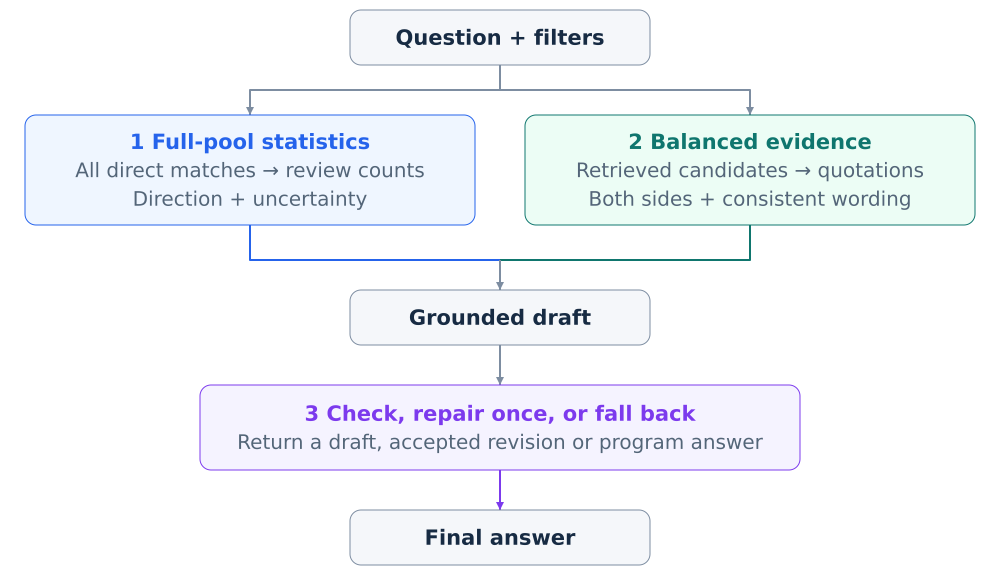
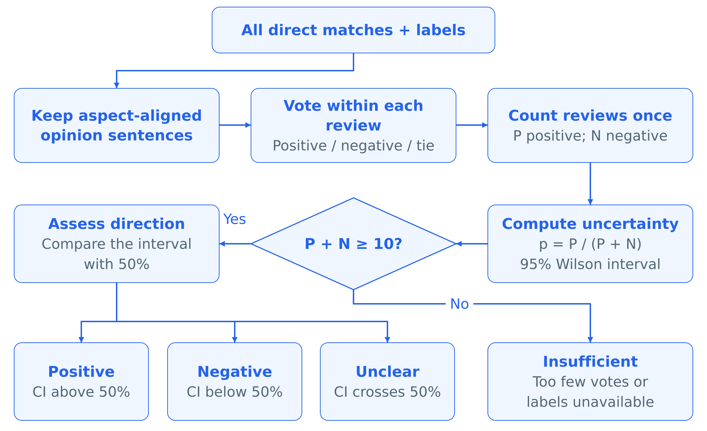
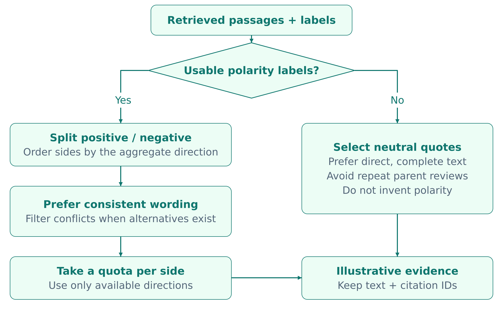
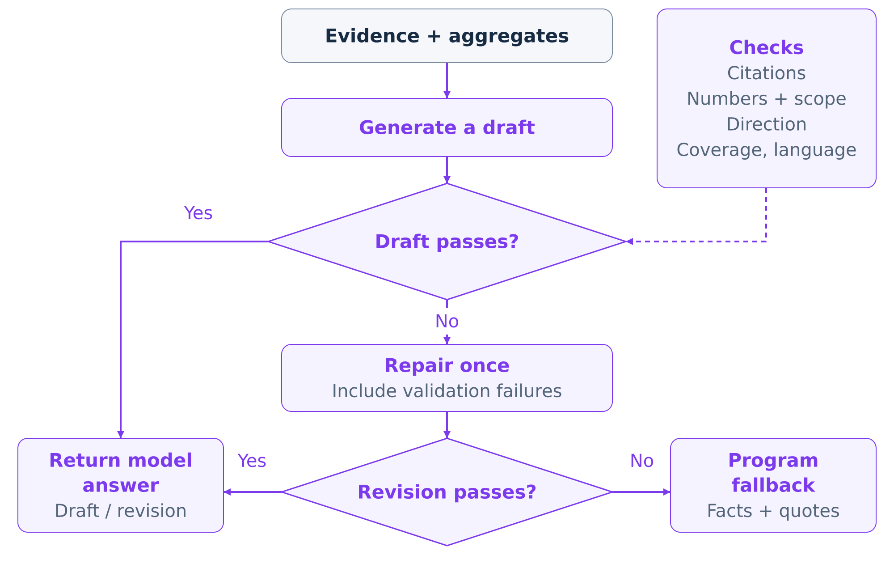
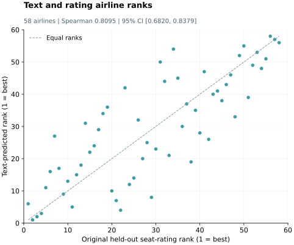

# Q5 — Downstream innovations and ablation studies

Our downstream task is to answer questions about airline reviews with conclusions that users can check against the source material. We introduce three complementary methods: deriving overall sentiment from the complete set of directly matching reviews, selecting representative evidence from both sides, and checking generated answers before returning them. The experiments show improvements in specific system behaviours, but do not establish an overall improvement in generated answer quality.

| Innovation | Problem addressed | Experiment type | Main result | What the evidence supports |
|---|---|---|---|---|
| Full-pool sentiment aggregation, with quotations used as examples | A few highly ranked passages can give a misleading impression of overall sentiment | Component diagnostic, 18 airline–subtopic units | Agreement with the full-pool direction: 12/18 → 18/18 | Consistency with the automatic aggregate, rather than independently verified sentiment accuracy |
| Balanced evidence selection with label–text consistency checks | Displayed evidence may omit opposing experiences or contain obvious conflicts between labels and wording | Selection diagnostic, 17 eligible units for two-sided coverage; conflict counts across all 18 units | Two-sided coverage: 11/17 → 17/17; obvious conflicts: 13 → 0 | Better evidence coverage and fewer detected conflicts in this sample |
| Answer validation, one repair attempt, and programmatic fallback | Valid citations alone do not prevent unsupported statistics or conclusions | Adversarial checks on 18 units; real-generation strategy replay on 12 development questions, including 7 generation questions | Wrong-direction rejection: 0/18 → 18/18; repair produced no change in final answers in the replay | The direction rule worked on the probes; an answer-quality benefit was not observed in the replay |

## 5.1 Downstream problems and evaluation settings

Retrieval and generation introduce different sources of error. First, the top-ranked passages are selected for relevance, so their sentiment distribution need not match the larger review pool. Second, a short evidence list can hide disagreement among reviewers. Third, a generated answer can cite a genuine review while making an unsupported claim about the overall population. The three methods below address these problems at the aggregation, evidence-selection, and answer-validation stages.

We use the aspect, subjectivity, and polarity predictions described in Q4 as existing inputs to this pipeline. The focus here is how those predictions support downstream answers. Improvements to the classifier itself are outside the present evaluation.

Objective sentences are excluded from positive/negative sentiment voting. A tie between opinion votes is recorded separately from objective content, and unavailable labels are kept distinct from an absence of relevant reviews. Sparse/dense fusion and retrieval ranking are evaluated in Q3; the methods here concern how the resulting evidence supports the final answer.

*Figure 5.1. Overview of the generated-answer path. Both evidence paths use the same query constraints: statistics support overall conclusions, while quotations illustrate experiences. Direct program answers can bypass model drafting.*

The evidence comes from separate experiments, whose settings and sample sizes must be kept distinct:

- **Component diagnostics, 19 October 2026.** The first 25 questions from the fixed 40-question smoke set supplied 18 airline–subtopic units with a clear direction under the full-pool automatic reference. Of these, 17 had both positive and negative examples available. The baseline disabled offline-label-assisted ordering and balanced preselection. Labels were subsequently attached to its retrieved passages for measurement. These comparisons therefore include changes in evidence ordering as well as selection. The results are recorded in the [component evaluation report](../../experiments/final_auto_eval/README.md) and its [per-unit results](../../experiments/final_auto_eval/results_20261019/downstream_ablation_per_case.csv).
- **Real-generation strategy replay, 31 October 2026: second complete-label development run (R2).** R2 identifies the experimental run, not an evaluator or model version. This run used Qwen3-4B-Instruct-2507 on Linux GPU in BF16, with the rebuilt v4.1 classifier and complete label coverage for the tested direct-match pools. It included 12 questions, of which 7 called the generator. The three policies shared each question's evidence and original model draft. Generation used temperature 0, a 480-token limit for each draft or repair, and an evidence budget of six passages per airline or aspect. The [frozen protocol](../../outputs/c_yi_development_20261031/protocol_full_labels_r2/protocol.json) records the model revision and input hashes.
- **Supplementary diagnostics.** Appendix Q5-A reports the historical seven-question template experiment separately. Appendix Q5-B describes the held-out text-based airline ranking diagnostic. Neither is treated as a real-generation ablation of the final system.

For answer-level evaluation, Faithfulness is supported checkable claims divided by all checkable claims; Answer Relevance is a 0–4 rubric score divided by four; and Context Precision is the number of displayed passages judged relevant divided by the number displayed. The relevance rubric ranges from off-topic (0) through partial (2) to complete coverage of the question (4). Scores are averaged over questions with a defined value, rather than pooling all claims or passages. R2 retains an undefined score when there are no checkable claims or no passages, as applicable.

In the second complete-label development run, Qwen3-4B-Instruct-2507 served as the automatic evaluator. It received the original English passages and separately supplied program-computed aggregates. A claim about a particular experience must be supported by the cited passage; a quantitative summary can be checked against the corresponding aggregate. These aggregates are computed from ratings or automatic labels, so supplying them to the evaluator does not independently verify their underlying correctness. Our Faithfulness proxy therefore checks support in the combined textual and structured evidence, rather than passage-only support. The historical template evaluator used displayed text, including translations when present, and supplied aggregates.

Both the historical template experiment and R2 used a Qwen3-4B model as the automatic judge. These are same-model proxy assessments, rather than independent human judgments or scores produced by the RAGAS library. The assignment names RAGAS as an example tool; we use an explicit custom rubric for the three requested dimensions and disclose its limitations. R2 questions had already been inspected during development. Historical Mac MLX 4-bit results, the earlier Linux run without labels, and the R2 configuration are therefore not pooled or used to estimate a single-component gain.

## 5.2 Innovation one: full-pool statistics and illustrative quotations

**Problem.** Treating the first few retrieved passages as a representative sample can reverse the answer's overall conclusion. A relevance ranking is useful for finding examples, but it does not justify estimating the proportion of positive reviews from those examples.

**Method.** We separate the statistical summary from its illustrations. Within the requested airline, cabin, route, and date constraints, the system identifies the complete directly matching review pool. Aspect-aligned subjective predictions are aggregated within each parent review to obtain a review-level direction, so a long review does not count as several independent reviewers. Positive and negative review counts determine the reported proportion; tied reviews and reviews without eligible sentiment votes are accounted for separately. An overall direction requires at least ten reviews with a determinate polarity and a 95% Wilson interval entirely above or below 50%. Otherwise, the system reports an inconclusive distribution or insufficient evidence. Missing statistics remain unavailable rather than becoming zero. A short list of quotations then illustrates the findings without determining the overall percentage.

*Figure 5.2. Full-pool aggregation. P and N count positive and negative parent reviews; ties and reviews without eligible votes are excluded from P + N. The interval thresholds determine direction only when at least ten reviews have a determinate polarity. Missing labels or no direct evidence leave the overall direction unavailable. CI denotes the 95% Wilson confidence interval.*

**Ablation results.** The October component diagnostic compared a top-10 passage vote with the full-pool reference on the same 18 airline–subtopic units.

| Measure | Top-10 passage vote | Full-pool aggregate | Evaluation unit and sample size |
|---|---:|---:|---|
| Agreement with the automatic full-pool direction | 66.7% (12/18) | 100% (18/18) | 18 airline–subtopic units with a clear reference direction |

The result shows that a conclusion based on the displayed sample can disagree with the larger automatic aggregate. The 100% value is an implementation-consistency result: the reference itself is the full-pool direction, and the evaluation script records the aggregate configuration as matching that reference. It is not an independent test of whether the classifier correctly captures human sentiment.

**Examples and interpretation.** In historical case Q01, concerning Singapore Airlines legroom, the baseline top-10 passages voted negative while the full-pool automatic reference was positive. This is a concrete reason to separate illustrative quotations from population summaries. A second example, R2 case A05 on Lufthansa economy meal portions, shows why the denominator and uncertainty also matter. Its 16 directly matching sentences came from 15 parent reviews: 5 reviews were positive, 6 negative, 1 tied, and 3 had no eligible aspect-sentiment votes. The positive share was therefore 5/11 = 45.5%, with a 95% interval of [21.27%, 71.99%]. The interval crosses 50%, so the system should describe the disagreement without presenting a reliable overall negative direction. Neither the 15 matched reviews nor the 16 sentences is the denominator for that sentiment percentage. These counts come from the [R2 development record](C乙_完整配置开发回归_20261031.md).

## 5.3 Innovation two: balanced and consistent evidence selection

**Problem.** Even when the aggregate direction is correct, a short evidence list may show only one kind of experience. Automatic labels can also conflict with the wording of a candidate passage, making an ostensibly positive example appear clearly negative to the reader.

**Method.** The system reserves space for examples from both sentiment directions when both are available. For a single subtopic, it selects up to two examples per direction; for multiple subtopics, it uses a smaller per-subtopic allocation. A label–text consistency heuristic prefers candidates whose positive or negative wording agrees with their predicted polarity. The check affects the choice of examples, while overall percentages continue to come from the full review pool. It does not replace the underlying classifier or guarantee semantic correctness for every passage.

*Figure 5.3. Polarity-labelled candidates are checked for obvious wording conflicts and selected within a quota for each available side. Conflicting candidates are filtered when alternatives exist. Without usable polarity labels, the system selects quotations without assigning them a sentiment direction. Neither path calculates the overall percentage from its selected examples.*

**Ablation results.** The historical diagnostic measured two-sided coverage and counted obvious wording conflicts in the selected examples.

| Measure | Baseline selection | Label-assisted balanced selection with consistency checks | Evaluation unit and sample size |
|---|---:|---:|---|
| Both positive and negative examples displayed when available | 64.7% (11/17) | 100% (17/17) | 17 eligible airline–subtopic units |
| Obvious label–text conflicts in selected examples | 13 | 0 | Conflict occurrences across the same 18 airline–subtopic units; the total number of selected examples was not reported |

For coverage, the baseline was the first four directly matching candidates. For conflict counts, it was a polarity-based selection from the baseline candidate list. These are different diagnostics, not two measurements of an identical selected set. Because the enhanced configuration also used label-assisted candidate ordering, the results support the selection procedure as a whole; they do not isolate the independent effects of balancing and consistency filtering. The historical template experiment in Appendix Q5-A also found no further change in its aggregate scores after the final filtering step.

**Example and interpretation.** A05 contains both a negative experience—“The food was ok but the portion was too small for such a long flight (~11.5 hrs).”—and a positive one—“Food was tasty, and the portion itself was comparable to other economy classes.” Presenting both helps explain the close 5-to-6 split without implying that the displayed examples determine the percentage. Better coverage makes disagreement visible, but the component diagnostic does not establish that this selection independently improves final-answer Faithfulness or Answer Relevance.

## 5.4 Innovation three: validation, one repair attempt, and fallback

**Problem.** An answer can contain valid citation identifiers while contradicting the aggregate direction, changing a statistical denominator, or extending a specific experience into an unsupported general claim. Citation-format checks alone cannot detect all of these failures.

**Method.** The answer pipeline checks citations, numerical claims, required coverage, and consistency with the supplied aggregate direction. If the draft fails, the generator receives one repair request describing the failures. If the repaired answer still fails, the system returns a programmatically assembled answer based on the available summaries and evidence. The original system already used this validation–repair–fallback design. Before the R2 evaluation, we added explicit missing-statistic states and stricter binding of counts to their airline, subtopic, and denominator. The three-policy comparison below tests this method; the comparison itself is not a separate innovation.

*Figure 5.4. The draft and revision undergo the same programmatic protocol checks, with at most one repair attempt. These runtime checks are separate from the Qwen-based automatic evaluator used to score experimental answers. Passing the checks does not guarantee semantic correctness. Direct-answer cases and model failures can use program answers outside the illustrated retry path.*

**Ablation results.** We first checked whether the direction rule rejects deliberately reversed conclusions. In the historical component experiment, a synthetic answer was constructed to oppose each unit's known automatic direction while retaining a valid citation identifier.

| Measure | Without the aggregate-direction check | With the aggregate-direction check | Evaluation unit and sample size |
|---|---:|---:|---|
| Rejection of deliberately wrong-direction answers | 0% (0/18) | 100% (18/18) | 18 synthetic answers, one per airline–subtopic unit |

This demonstrates the rule's behaviour on those probes. It does not measure how often naturally generated answers fail or whether replacing them improves answer quality.

The R2 replay evaluated that second question using real model drafts. Each generation question shared the same evidence and original draft across the following policies:

- **full:** validate the draft, attempt one repair if necessary, then fall back if the repair fails.
- **no_repair:** validate the draft, then fall back immediately if it fails.
- **no_guard:** retain the original draft without validation, repair, or validation-triggered fallback; this policy was used only for offline analysis.

Five questions were answered directly by program logic: two rating comparisons, one meal-evidence summary, and two empty-slice responses. They remain in the descriptive 12-question summary but are excluded from the seven-question generation-policy comparison. Identical final answers received a shared judge assessment.

| Policy | Faithfulness | Answer Relevance | Context Precision | Sample unit |
|---|---:|---:|---:|---|
| full | 0.8408 (n=10) | 1.0000 (n=12) | 0.7750 (n=10) | Question |
| no_repair | 0.8408 (n=10) | 1.0000 (n=12) | 0.7750 (n=10) | Question |
| no_guard | 0.8665 (n=10) | 1.0000 (n=12) | 0.8083 (n=10) | Question |

Faithfulness and Context Precision have ten scored questions because the two empty-slice answers have no checkable claims or displayed evidence. Answer Relevance includes all twelve questions. The complete [R2 summary](../../outputs/c_yi_development_20261031/answers_full_labels_r2/summary.json) preserves the missing values and sample counts.

The full policy used fallback on all seven generation questions, adopting no original or repaired model answer. Its final text matched no_repair on all twelve questions. Adding the repair attempt therefore produced no observed final-answer benefit in this run, while requiring an additional generation attempt for each rejected draft. Across the seven generation questions, full minus no_guard had a paired Faithfulness difference of **−0.0367**, with a question-level bootstrap 95% interval of **[−0.0912, −0.0048]**. The proxy score was lower under the full policy in this development sample. This comparison evaluates the combined validation, repair, and fallback policy; it does not isolate validation from fallback. All three policies used identical evidence, so differences in answer-conditioned Context Precision judgments cannot be interpreted as retrieval improvements.

For context, full-policy time from retrieval start to the completed answer had a median of 22.95 seconds and a P95 of 48.63 seconds across the twelve questions, including translation and excluding judge scoring. These are total response times, not first-token latencies or measured latency differences between policies. They are not compared directly with historical Mac timings.

**Failure example and interpretation.** R2 case A06 exposes a limitation beyond citation and count checks. An English source compared privacy with an Emirates first-class suite, but the Chinese translation named Ethiopian Airlines. That translated passage then entered the programmatic fallback. This source-to-output comparison is an AI-assisted diagnosis, not a human evaluation score. It shows that fallback can preserve an upstream translation error. The stricter statistical format can also reject numerically correct paraphrases, so a failed protocol check should not automatically be called a factual error. A successful check or the compatibility field `valid=True` likewise does not establish semantic correctness. The automatic judge itself produced inconsistencies between claim counts and listed unsupported examples, which further limits interpretation of its scores.

## 5.5 Discussion and limitations

The component diagnostics support three specific observations: full-pool aggregation avoids disagreements caused by top-k sentiment voting, balanced selection exposes both sides more often, and a direction check rejects deliberately contradictory conclusions. These are useful checks of system behaviour. The R2 replay provides a different finding: one repair attempt did not change the final answers, and the full policy received lower Faithfulness proxy scores than the unguarded drafts on the seven generation questions. Overall answer-quality improvement therefore remains unproven. Repair may behave differently on other questions or with a different generator, so this result does not establish that repair is generally ineffective.

The evidence also falls short of a complete multi-component ablation. The historical sequence adds aggregation, balanced selection, and filtering progressively, while some component comparisons change candidate ordering at the same time. It lacks a common-baseline comparison of **X only, Y only, and X+Y**, as requested in the assignment example. A controlled combination study is still needed before submission to separate independent contributions and interactions.

Other limits are the small samples, development exposure, reliance on automatic sentiment labels, and same-model answer judging. The full-pool direction is not human ground truth, and Wilson intervals describe the observed labelled review distribution rather than uncertainty in classifier correctness. Broader claims require stable final settings and new questions that have not guided development, with independent review of the answers and their source support. The known translation error also remains unresolved. The later single-question A08 check and the separate no-label A05 control are not substituted into the R2 totals.

For the final submission, the Q5 supporting data must accompany the report through the shared data archive: questions and constraints, retrieved passages with identifiers, aggregate snapshots, original drafts, repair attempts, final answers, policy assignments, and raw judge outputs and summaries. The separate source-code archive should include the evaluation scripts, dependency specifications, and run instructions. The final report needs accessible links to both archives, as required in the assignment; local source links in this draft provide traceability during writing but do not replace those links. Dataset construction, annotator agreement, classification quality, and broader throughput/cost/scalability analysis remain documented under Q4.

## Appendix Q5-A — Historical template-based diagnostic

The 19 October experiment constructed answers with `ablation_answer()` and asked a local MLX Qwen3-4B 4-bit judge to score them. It did not call the production generator separately for each configuration. The table documents a historical mechanism diagnostic, rather than real model generation. For readability, the configurations are labelled M0–M3; their original names are retained so the results can be traced to the saved records.

| Configuration | Original name | Agreement with automatic direction | Faithfulness | Answer Relevance | Context Precision | Evaluation unit and sample size |
|---|---|---:|---:|---:|---:|---|
| M0: top-10 direction and naive examples | A_top10_naive | 0.8571 | 0.8571 | 1.0000 | 0.9286 | 7 questions per configuration |
| M1: full-pool direction, same naive examples | B_full_aggregate | 1.0000 | 0.8286 | 0.9643 | 0.9286 | Same 7 questions |
| M2: full-pool direction and balanced examples | C_balanced_evidence | 1.0000 | 0.7929 | 0.9286 | 1.0000 | Same 7 questions |
| M3: M2 followed by consistency filtering | D_consistency_filter | 1.0000 | 0.7929 | 0.9286 | 1.0000 | Same 7 questions |

The identical M2 and M3 scores provide no evidence of an additional answer-score gain from the last step in this sample. Faithfulness and Answer Relevance did not improve monotonically as components were added. Because both answer construction and judging differ from R2, these scores are not pooled with the real-generation results. Sources: [historical evaluation report](../../experiments/final_rag_eval/results_20261019/README.md), [summary](../../experiments/final_rag_eval/results_20261019/results.json), and [experiment implementation](../../experiments/final_rag_eval/run.py).

## Appendix Q5-B — Supplementary text-based ranking diagnostic

A separate diagnostic examined whether text-derived seat sentiment could reproduce airline rankings based on held-out seat ratings. Approximately 20% of parent reviews were held out, with evaluation parents and duplicate texts excluded from training. A dedicated classifier predicted from text and identifying metadata; held-out ratings were read only after predictions had been saved and frozen. Ratings from the training side still contributed to weak supervision. The method first calculated sentiment at review level, then averaged across reviews within each airline, limiting the influence of review length.

The run included **58 airlines** and achieved Spearman correlation **0.8095**, with a 95% bootstrap interval of **[0.6820, 0.8379]**. Of **8,365** held-out reviews with reference seat ratings, **3,152** had usable seat-sentiment predictions. The interval used 2,000 within-airline parent-review resamples over a fixed airline set; it does not include model-retraining uncertainty.

*Figure Q5-B.1. Text-predicted ranks versus held-out seat-rating ranks. Each point represents one of the 58 included airlines; the dashed line marks equal ranks. This figure uses the existing frozen ranking results and does not represent a new experiment.*

This was a separate text-classification-to-ranking diagnostic recorded on 24 October 2026, not an ablation of the three methods above. It does not evaluate the interface's rating-based ranking or establish ground truth for finer attributes such as legroom. It was not rerun for R2. Source: [frozen ranking report](../../outputs/c_q5_ranking_20261024_v1/report.json) and [evaluation protocol description](../../experiments/downstream_evaluation/README.md).

The `outputs/` links refer to local, Git-ignored experiment artifacts. Those supporting records need to accompany the report when it is handed over for verification.
