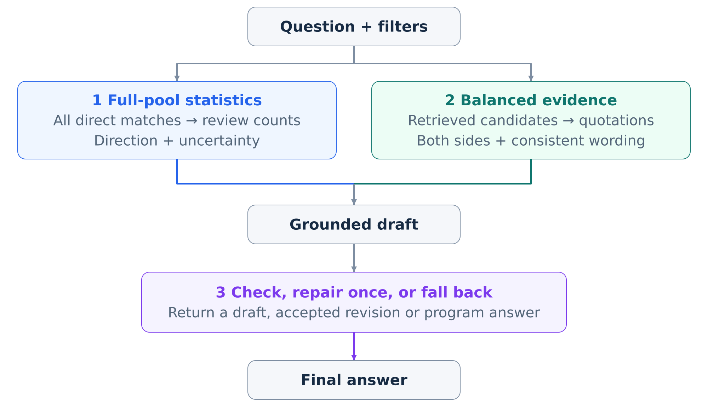
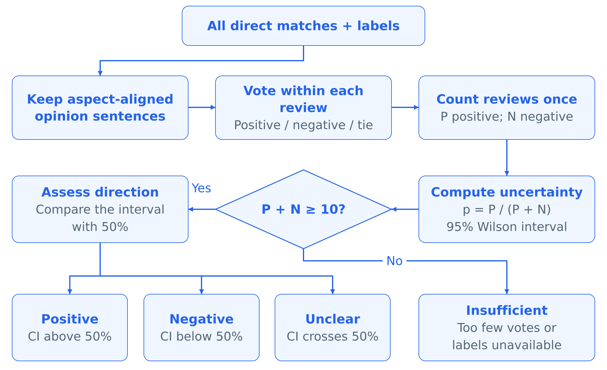
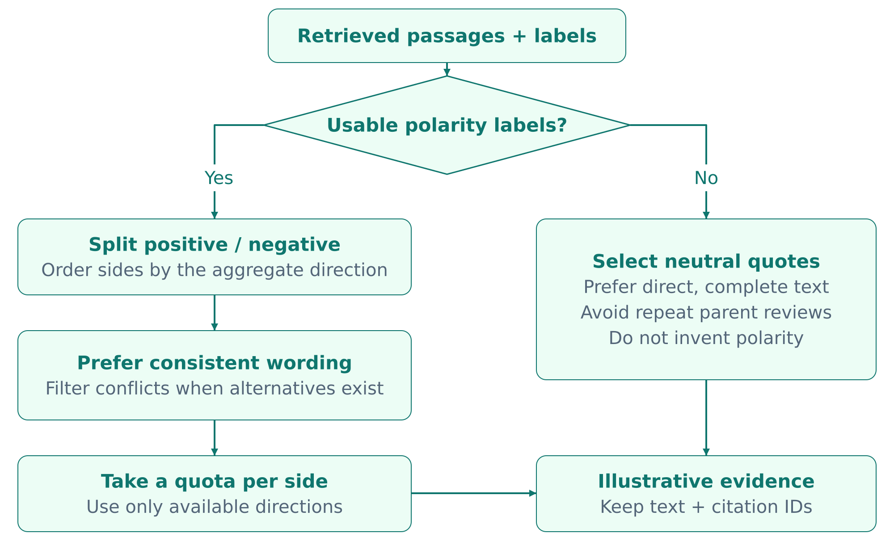
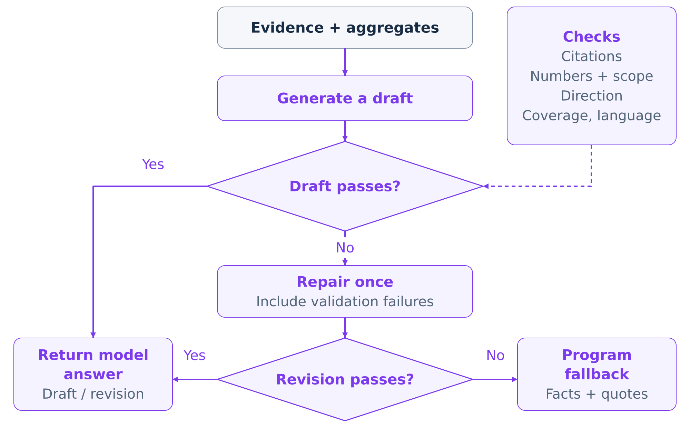
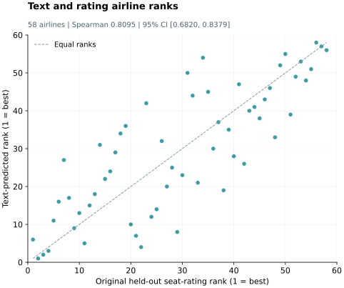

# Q5：下游创新与消融实验

本项目的下游任务是回答航空评论相关问题，并让用户能够根据原始材料核对结论。我们采用三项互补的方法：利用完整直接匹配评论池判断总体情感，选择兼顾正反意见的代表性证据，以及在返回答案前检查生成内容。现有实验表明，部分具体机制的表现有所改善，但尚未证明生成答案的整体质量得到提升。

| 创新 | 解决的问题 | 实验类型 | 主要结果 | 证据能够支持的结论 |
|---|---|---|---|---|
| 完整评论池情感汇总，引用仅作举例 | 少量排名靠前的片段可能使总体情感判断失真 | 18 个“航司×细分项”单元的组件诊断 | 与全量参考方向一致：12/18 → 18/18 | 与自动汇总结果保持一致，不代表经独立验证的情感准确率 |
| 正反平衡选例与标签—文本一致性检查 | 展示证据可能遗漏相反经历，或出现标签与措辞明显冲突的例子 | 正反覆盖使用 17 个符合条件的单元；冲突数统计覆盖全部 18 个单元 | 正反覆盖：11/17 → 17/17；明显冲突：13 → 0 | 在本批样本中提高证据覆盖并减少被检测到的冲突 |
| 生成后校验、一次修正与程序回退 | 引用编号有效，不代表统计与结论都有依据 | 18 个单元的对抗检查；12 道开发题的真实生成策略回放，其中 7 道调用生成器 | 错误方向拦截：0/18 → 18/18；回放中修正未改变最终答案 | 方向规则在探针上有效；回放中未观察到回答质量收益 |

## 5.1 下游问题与评测设置

检索与生成会引入不同类型的错误。首先，排名靠前的片段是按相关性选出的，其情感分布未必能代表更大的评论池。其次，有限的证据列表可能掩盖评论者之间的分歧。最后，生成答案即使引用了真实评论，也可能据此作出缺乏支持的总体判断。下文的三项方法分别在统计汇总、证据选择和答案校验阶段处理这些问题。

Q4 中介绍的方面、主客观和极性预测，是这一流程的已有输入。本节关注如何利用这些预测支持下游回答，不评估分类器本身的新增改进。

客观句不参与正负情感投票。主观评价的正负票持平与客观内容分别记录；标签不可用也不等于没有相关评论。稀疏与稠密检索的融合及排序在 Q3 中评估，本节讨论这些证据如何支持最终答案。

*图 5.1：生成式回答的总体流程。两条证据路径使用相同的查询约束：统计支持总体结论，引用说明具体经历。程序直接回答的题目可以跳过模型初稿生成。*

现有证据来自不同实验，设置与样本量需要分别说明：

- **组件诊断，2026 年 10 月 19 日。** 固定 40 题冒烟测试集的前 25 题中，有 18 个“航司×细分项”单元在全量自动参考下具有明确方向，其中 17 个同时存在正反例。基线关闭离线标签辅助排序与平衡预选，随后再为其检索结果补充标签，以便测量。因此，对照同时涉及证据排序和选例的变化。结果见[组件评测报告](../../experiments/final_auto_eval/README.md)及[逐单元记录](../../experiments/final_auto_eval/results_20261019/downstream_ablation_per_case.csv)。
- **真实生成策略回放，2026 年 10 月 31 日，第二轮完整标签开发实验（R2）。** R2 仅标记实验轮次，不是评委或模型版本。本轮在 Linux GPU 上运行 BF16 的 Qwen3-4B-Instruct-2507，使用重建的 v4.1 分类器，受测直接匹配池具有完整标签覆盖。共 12 题，其中 7 题调用生成器；每题的三种策略共享相同证据和同一次模型初稿。生成温度为 0，初稿与修正版均最多 480 token，每个航司或方面的证据预算为六条。[冻结协议](../../outputs/c_yi_development_20261031/protocol_full_labels_r2/protocol.json)保存模型 revision 与输入哈希。
- **补充诊断。** 附录 Q5-A 单独列出历史七题模板实验；附录 Q5-B 介绍基于留出评论的文本航司排名诊断。两者均不作为最终系统的真实生成消融。

回答级评测中，Faithfulness 为受支持的可核查论断数除以全部可核查论断数；Answer Relevance 为 0–4 分的相关性评分除以四；Context Precision 为被判定相关的展示片段数除以全部展示片段数。相关性评分从偏离问题（0 分）、部分回答（2 分）到完整覆盖问题（4 分）。各指标按有定义分值的题目取平均，不把全部题目的论断或片段合并计算。R2 中，没有可核查论断或没有片段时，相应指标保留为未定义。

在第二轮完整标签开发实验中，我们使用 Qwen3-4B-Instruct-2507 作为自动评委。它读取英文原始片段和另外提供的程序汇总。具体经历需要对应引用原文支持；定量总结可与相应汇总核对。汇总来自评分或自动标签，提供给评委并不构成对其基础正确性的独立验证。因此，本项目的 Faithfulness 代理分数检验的是文本与结构化证据共同提供的支持，而非仅限于片段原文的支持。历史模板实验的自动评委则读取展示文本（若有译文则包括译文）及提供的汇总。

历史模板实验和 R2 均使用 Qwen3-4B 模型作为自动评委。这些是同模型代理评测，不是独立人工判断，也不是 RAGAS 库生成的分数。作业将 RAGAS 列为示例工具；本项目使用明确的自定义 rubric 评价所要求的三个维度，并披露其局限。R2 题目已在开发期间被检查过。历史 Mac MLX 4bit、较早的 Linux 无标签运行和 R2 配置不合并统计，也不用于估计某个单一组件的收益。

## 5.2 创新一：完整评论池统计与引用分工

**问题。** 如果把前几条检索片段视为具有代表性的样本，答案的总体判断可能被反转。相关性排序有助于寻找例子，却不能据此估计总体正向评论比例。

**方法。** 我们将统计总结与例子分开。在指定航司、舱位、航线和日期约束下，系统识别完整的直接匹配评论池。符合方面与主观性条件的预测先在父评论内部汇总，形成评论级方向，使一篇长评论不会被视为多名独立评论者。正负评论数决定所报告的比例；持平评论与没有合格情感票的评论分别记录。总体方向要求至少十条可判定极性的评论，且 95% Wilson 区间完全高于或低于 50%；否则报告分布无法明确区分，或证据不足。缺失统计保留为不可用，不转换成零。少量引用用于说明具体经历，不决定总体百分比。

*图 5.2：完整评论池汇总。P、N 分别为正负向父评论数，持平评论与没有合格情感票的评论不纳入 P + N。仅当至少十条评论具有明确极性时，才根据区间阈值判断总体方向。标签缺失或没有直接证据时，总体方向不可用。CI 表示 95% Wilson 置信区间。*

**消融结果。** 十月组件诊断在相同的 18 个“航司×细分项”单元上，对比了 top-10 片段投票和全量参考。

| 指标 | top-10 片段投票 | 完整评论池汇总 | 评测单位与样本量 |
|---|---:|---:|---|
| 与全量自动参考方向一致 | 66.7%（12/18） | 100%（18/18） | 18 个具有明确参考方向的“航司×细分项”单元 |

这表明，展示样本得出的结论可能与更大的自动汇总相冲突。100% 属于实现一致性结果：参考本身就是全量方向，评测脚本将汇总配置记录为与该参考一致。它不是对分类器是否正确反映人工情感判断的独立测试。

**案例与解释。** 历史 Q01 涉及新加坡航空的腿部空间，基线 top-10 片段投票为负面，而完整池的自动参考为正面。这说明举例片段与总体统计应分别处理。R2 的 A05 涉及汉莎航空经济舱餐食分量，进一步说明了分母与不确定性的重要性。16 个直接匹配句子来自 15 条父评论：5 条正向、6 条负向、1 条持平，另有 3 条没有合格的方面情感票。正向比例因此为 5/11 = 45.5%，95% 区间为 [21.27%, 71.99%]。区间跨过 50%，系统可以描述分歧，但不能给出可靠的总体负面判断。15 条匹配评论和 16 个句子都不是这个情感比例的分母。相关计数见 [R2 开发记录](C乙_完整配置开发回归_20261031.md)。

## 5.3 创新二：正反平衡与一致性约束的证据选择

**问题。** 即使总体方向正确，有限的证据列表也可能只展示一种经历。自动标签还可能与候选片段的措辞冲突，使一条被当作正面例子的评论，在读者看来明显是负面的。

**方法。** 同时存在正反意见时，系统为两个方向都预留展示位置。单细分项最多选择每个方向两条例子，多细分项则减少每项配额。标签—文本一致性启发式规则优先选择情感措辞与预测极性相符的候选。该检查影响例子选择，总体百分比仍来自完整评论池。它既不替代底层分类器，也不能保证每个片段的语义都判断正确。

*图 5.3：带极性标签的候选先接受明显措辞冲突检查，再按每个可用方向的配额选取；存在替代候选时过滤冲突例子。没有可用极性标签时，选择引用片段但不为其指定情感方向。两条路径都不根据所选例子计算总体比例。*

**消融结果。** 历史诊断测量了正反覆盖，并统计选中例子中明显的措辞冲突。

| 指标 | 基线选择 | 标签辅助的正反平衡选择与一致性检查 | 评测单位与样本量 |
|---|---:|---:|---|
| 存在正反意见时，同时展示两类例子 | 64.7%（11/17） | 100%（17/17） | 17 个符合条件的“航司×细分项”单元 |
| 选中例子中的明显标签—文本冲突 | 13 | 0 | 相同 18 个单元中的冲突次数；原汇总未报告所选例句总数 |

覆盖指标的基线是前四条直接匹配候选；冲突计数的基线则从基线候选列表按极性选择。因此，两项诊断并非对同一组选中例子的两个测量。增强配置也使用了标签辅助候选排序，所以结果支持的是整体选例流程，尚不能独立分离平衡与一致性过滤的作用。附录 Q5-A 的历史模板实验在最后加入过滤后，汇总分数也没有进一步变化。

**案例与解释。** A05 同时包含负面经历：“The food was ok but the portion was too small for such a long flight (~11.5 hrs).”（食物尚可，但对于如此长的航程，分量太少。）也包含正面经历：“Food was tasty, and the portion itself was comparable to other economy classes.”（食物可口，分量与其他经济舱相当。）同时展示两类经历，有助于解释接近的 5 比 6 分布，而不会让读者误以为百分比来自眼前这几个例子。更好的覆盖让分歧可见，但这项组件诊断尚不能证明该选例方法独立提高了最终回答的 Faithfulness 或 Answer Relevance。

## 5.4 创新三：生成后校验、一次修正与程序回退

**问题。** 答案可能使用有效的引用编号，却同时违背全量方向、改变统计分母，或把个别经历扩展为缺乏依据的总体判断。仅检查引用格式无法发现全部此类问题。

**方法。** 回答流程检查引用、数值论断、所需内容覆盖，以及与给定总体方向的一致性。初稿未通过时，生成器收到一次说明失败原因的修正请求；修正版仍未通过，则返回由程序依据已有汇总和证据组装的答案。原系统已采用这一校验—修正—回退设计。R2 评测前，我们补充了明确的统计缺失状态，并更严格地将计数绑定到对应航司、细分项和分母。下文三策略比较用于检验这一方法，比较设计本身不另算创新。

*图 5.4：初稿与修正版接受相同的程序协议检查，最多修正一次。这些运行时检查与实验中使用 Qwen 模型评分的自动评委分别承担不同职责。通过检查不保证语义正确。程序直接回答和模型调用失败的情况可以在图示重试路径之外返回程序答案。*

**消融结果。** 首先检查方向规则能否拒绝故意反转结论的回答。历史组件实验为每个单元构造一条与已知自动方向相反、但保留有效引用编号的合成答案。

| 指标 | 不启用全量方向检查 | 启用全量方向检查 | 评测单位与样本量 |
|---|---:|---:|---|
| 故意反转方向的答案被拒绝 | 0%（0/18） | 100%（18/18） | 18 条合成答案，每个“航司×细分项”单元一条 |

该结果说明规则在这些探针上的行为，不能衡量自然生成答案的失败频率，也不能说明替换这些答案后质量是否改善。

R2 使用真实模型初稿检验后一问题。每道生成题在以下策略间共享相同证据与同一次初稿：

- **full：** 校验初稿；必要时修正一次；修正失败则回退。
- **no_repair：** 校验初稿；失败则直接回退。
- **no_guard：** 保留原始初稿，不进行校验、修正或由校验触发的回退；仅用于离线分析。

另有五题由程序直接回答：两题评分比较、一题餐食证据总结和两题空切片响应。这些题目保留在十二题的描述性汇总中，但不纳入七道生成题的策略配对比较。相同的最终答案共享一次评委评分。

| 策略 | Faithfulness | Answer Relevance | Context Precision | 样本单位 |
|---|---:|---:|---:|---|
| full | 0.8408（n=10） | 1.0000（n=12） | 0.7750（n=10） | 题目 |
| no_repair | 0.8408（n=10） | 1.0000（n=12） | 0.7750（n=10） | 题目 |
| no_guard | 0.8665（n=10） | 1.0000（n=12） | 0.8083（n=10） | 题目 |

两道空切片回答没有可核查论断和展示证据，因此 Faithfulness 与 Context Precision 均有十题可计分。Answer Relevance 包含全部十二题。完整的 [R2 汇总](../../outputs/c_yi_development_20261031/answers_full_labels_r2/summary.json)保留了缺失值和样本数。

full 在全部七道生成题上回退，没有采用任何原始或修正后的模型答案；其最终文本在十二题上均与 no_repair 相同。因此，本轮加入修正没有带来可观察的最终答案收益，却为每道被拒绝的初稿增加了一次生成尝试。七道生成题中，full 减去 no_guard 的配对 Faithfulness 差值为 **−0.0367**，问题级 bootstrap 95% 区间为 **[−0.0912, −0.0048]**。在这批开发题上，完整策略的代理分数更低。该比较评价校验、修正与回退的组合策略，不能把校验与回退的作用分别归因。三种策略的证据完全相同，因此，评委在答案条件下给出的 Context Precision 差异不能解释为检索改善。

作为性能背景，十二题中 full 从检索开始到最终答案完成的中位时间为 22.95 秒，P95 为 48.63 秒，包括翻译，不包括评委评分。这是总响应时间，不是首 token 延迟，也不是实测的策略间延迟差。它不与历史 Mac 耗时直接比较。

**失败案例与解释。** R2 的 A06 暴露了引用和计数检查之外的局限。英文原文将隐私体验与 Emirates 的头等舱套房比较，但中文译文把航司写成了“埃塞俄比亚航空”，该译文又进入程序回退答案。这是根据原文与输出作出的 AI 辅助诊断，不是人工评测分数。它说明回退仍可能保留上游翻译错误。更严格的统计格式也可能拒绝数值正确的改写，所以不能把协议检查失败一律视为事实错误。反过来，检查成功或兼容字段 `valid=True` 也不能证明语义正确。自动评委自身还存在论断计数与所列不受支持例子之间的矛盾，进一步限制了分数的解释。

## 5.5 综合讨论与局限

组件诊断支持三个具体观察：完整池汇总避免了 top-k 情感投票带来的方向冲突，平衡选例更经常展示两类意见，方向检查能够拒绝故意相反的结论。这些是有价值的机制检查。R2 回放则给出了不同发现：一次修正没有改变最终答案，完整策略在七道生成题上的 Faithfulness 代理分数低于未经校验的初稿。因此，整体回答质量的改善尚未得到证明。修正在其他问题或其他生成器上可能表现不同，本次结果不构成修正普遍无效的证明。

现有证据也未构成完整的多组件消融。历史配置依次加入汇总、正反平衡和过滤，部分组件对照还同时改变候选排序。它缺少作业示例所要求的共同基线下 **仅 X、仅 Y、X+Y** 的比较。提交前仍需补充受控组合实验，才能区分独立贡献与交互作用。

其他局限包括样本较小、题目已参与开发、依赖自动情感标签，以及生成器与评委使用同类模型。完整池方向不是人工真值，Wilson 区间描述的是观测到的标签分布，而非分类器正确性的不确定性。若要提出更广泛的结论，需要稳定最终设置，在未指导开发的新题上评测，并独立核对答案及其原文支持。已知翻译错误也尚未解决。后续 A08 单题检查和独立的 A05 无标签控制均未替换进 R2 汇总。

最终提交时，应通过共享数据压缩包提供 Q5 的支持材料：问题与筛选约束、带标识的检索片段、汇总快照、原始初稿、修正尝试、最终答案、策略对应关系，以及评委原始输出和统计汇总。另一个源码压缩包应包含评测脚本、依赖说明和运行方法。按作业要求，总报告需要给出这两个压缩包的可访问链接；本稿中的本地来源链接便于写作追溯，不能替代共享链接。数据集构造、标注一致率、分类质量，以及更完整的吞吐、成本和扩展性分析仍在 Q4 中说明。

## 附录 Q5-A：历史模板诊断

10 月 19 日实验使用 `ablation_answer()` 构造答案，再由本地 MLX Qwen3-4B 4bit 评委评分，没有为每种配置单独调用生产生成器。此表记录历史机制诊断，不代表真实模型生成。为便于阅读，配置命名为 M0–M3，并保留原名以追溯保存的记录。

| 配置 | 原始名称 | 与自动方向一致 | Faithfulness | Answer Relevance | Context Precision | 评测单位与样本量 |
|---|---|---:|---:|---:|---:|---|
| M0：top-10 方向与朴素例子 | A_top10_naive | 0.8571 | 0.8571 | 1.0000 | 0.9286 | 每种配置 7 题 |
| M1：全量方向，相同朴素例子 | B_full_aggregate | 1.0000 | 0.8286 | 0.9643 | 0.9286 | 相同 7 题 |
| M2：全量方向与正反平衡例子 | C_balanced_evidence | 1.0000 | 0.7929 | 0.9286 | 1.0000 | 相同 7 题 |
| M3：在 M2 上增加一致性过滤 | D_consistency_filter | 1.0000 | 0.7929 | 0.9286 | 1.0000 | 相同 7 题 |

M2 与 M3 分数相同，因此本批样本没有提供最后一步带来额外答案评分收益的证据。Faithfulness 与 Answer Relevance 也未随着组件增加而单调改善。答案构造与评分输入均不同于 R2，所以这些分数不与真实生成结果合并。来源：[历史评测报告](../../experiments/final_rag_eval/results_20261019/README.md)、[汇总结果](../../experiments/final_rag_eval/results_20261019/results.json)和[实验实现](../../experiments/final_rag_eval/run.py)。

## 附录 Q5-B：补充文本排名诊断

另一项独立诊断检验：根据文本预测的座位情感，能否重现留出座位评分形成的航司排名。约 20% 的父评论留出，训练中排除评测父评论与重复文本。专用分类器仅根据文本和标识元数据预测，预测保存并冻结后才读取留出评分；训练侧评分仍参与弱监督。方法先在评论级计算情感，再按航司对评论取均值，以限制评论长度的影响。

本次纳入 **58 家航司**，Spearman 相关系数为 **0.8095**，95% bootstrap 区间为 **[0.6820, 0.8379]**。**8,365** 条具有参照座位评分的留出评论中，**3,152** 条有可用座位情感预测。区间基于固定航司集合内的 2,000 次父评论重采样，不包含重新训练模型的不确定性。

*图 Q5-B.1：文本预测排名与留出座位评分排名。每个点代表纳入的 58 家航司之一，虚线表示两种名次相同。图基于既有冻结排名结果绘制，不代表新增实验。*

这是记录于 2026 年 10 月 24 日的独立文本分类—排名诊断，不是上述三项方法的消融。它不评估界面中基于原始评分的排名，也不建立腿部空间等细分属性的真值。R2 没有重跑该实验。来源：[冻结排名报告](../../outputs/c_q5_ranking_20261024_v1/report.json)及[评测协议说明](../../experiments/downstream_evaluation/README.md)。

`outputs/` 链接指向被 Git 忽略的本地实验产物。交接报告时，需要同时提供这些支持记录以供核对。
