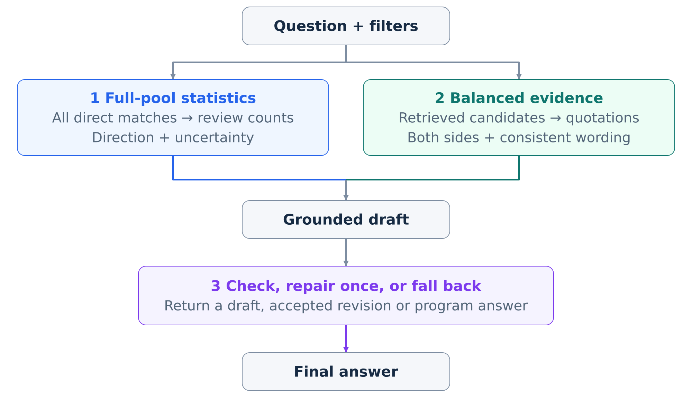
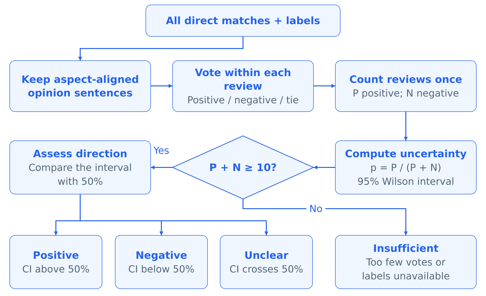
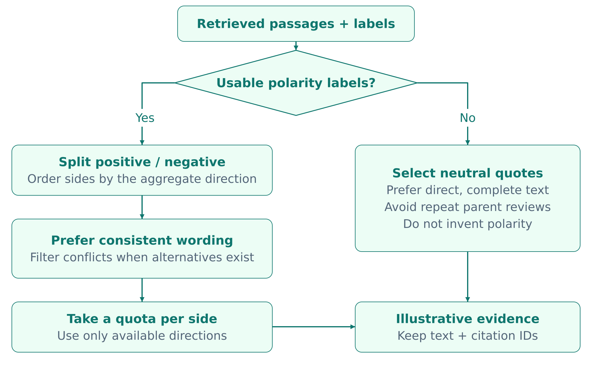
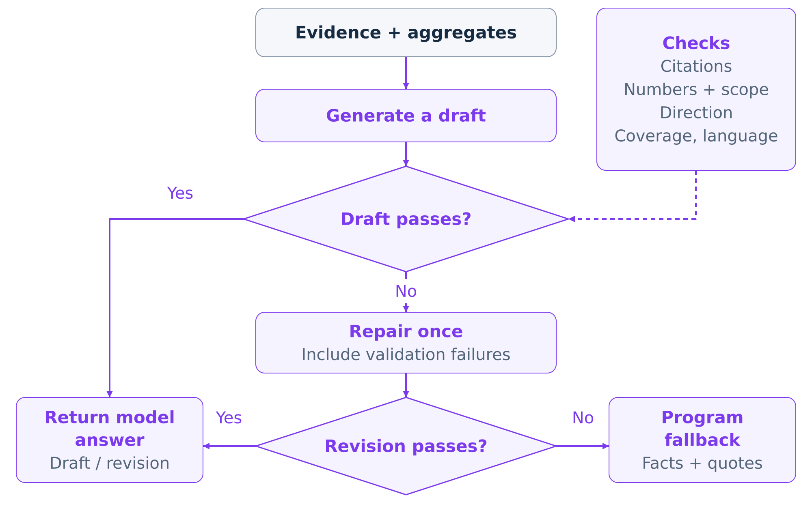
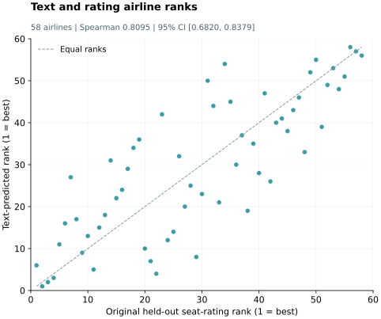

# Q5 — Downstream innovations

Our system answers questions about airline experiences by combining review-level statistics with cited examples. This requires more than retrieving relevant passages: a short ranked list can misrepresent the wider review collection, omit opposing experiences, or support a fluent answer with incorrect numbers. We introduce three downstream components: **X, full-pool statistics; Y, balanced and consistency-aware evidence selection; and Z, validation with one repair attempt and programmatic fallback**.

## 5.1 Design overview

The aspect, subjectivity and sentiment classifiers described in Q4 supply labels for the source sentences. The three components use these labels and retrieved text to separate aggregate reporting, example selection and answer checking.

| Component | Problem | Contribution |
|---|---|---|
| X: full-pool statistics | Top-k sentiment votes can give a distorted overall impression; multiple sentences can overcount one review | Aggregate eligible sentences within each review, then report the distribution and uncertainty across the complete matching pool |
| Y: balanced, consistent examples | A short evidence list can hide disagreement or contain obvious label–text conflicts | Select examples from both available sentiment sides, prioritising compatible wording and readable quotations |
| Z: validation, repair and fallback | Valid citation identifiers do not ensure correct numbers or supported conclusions | Check the draft, request one revision on failure, and assemble an answer from supplied facts and quotations if the revision fails |

*Table 5.1. The three components address different stages of evidence use.*

*Figure 5.1. The matching review pool supplies aggregate statistics; selected passages illustrate individual experiences. Both feed the generator and answer checks.*

We evaluate their contributions with all eight X/Y/Z combinations on twenty questions. Sections 5.2–5.4 explain the mechanisms and show actual examples; Section 5.5 reports answer-level ablations, Section 5.6 adds airline ranking validation against passenger ratings, and Section 5.7 discusses cost and design tradeoffs. Earlier mechanism checks are summarised in Appendix Q5-B.

## 5.2 X: full-pool statistics

Retrieval ranks passages for relevance, whereas an overall sentiment statement requires a defined set of reviews. X uses the complete pool matching the airline, cabin and attribute-specific text cues. Within each parent review, it aggregates subjective sentiment votes whose predicted aspect matches the question, then counts that review once as positive or negative. Ties and reviews without eligible votes are recorded separately.

The positive share is **P / (P + N)**. A clear positive or negative direction requires at least ten determinate reviews and a 95% Wilson interval entirely above or below 50%. Otherwise the system reports insufficient evidence or no clear one-sided direction. These statistics describe automatic labels within the matching corpus; missing statistics remain unavailable.

*Figure 5.2. Review-level aggregation prevents repeated sentences from becoming independent votes. Ties and reviews without eligible votes are excluded from P + N.*

**Example: Singapore Airlines economy legroom (Q01).** Three of the first four baseline passages have negative labels. Across the matching pool, however, there are 78 positive and 20 negative determinate reviews, 3 ties and 30 reviews without eligible votes. X reports **78/98 = 79.6% positive**, with Wilson interval **[70.57%, 86.38%]**. The answer can therefore describe a positive aggregate direction while still citing cramped-seat experiences. For Q07, about meal portions, only nine reviews are determinate: six positive and three negative. X reports insufficient evidence for a reliable overall direction.

The contribution is a consistent basis for aggregate claims: counts come from the matching review pool, while quotations explain individual experiences. This also makes the denominator explicit to the reader.

## 5.3 Y: balanced and consistency-aware evidence selection

A useful opinion summary should show relevant disagreement. Y partitions the ranked candidates by predicted polarity and selects up to two examples from each available side. Within each group, lexical sentiment cues favour wording compatible with the label, followed by quotation readability; obvious conflicts are excluded when suitable alternatives exist. If no polarity-labelled examples can be selected, the system uses direct, self-contained quotations without assigning polarity.

*Figure 5.3. Y combines sentiment coverage and wording–label consistency. Side ordering follows X's aggregate direction when supplied, and a fixed order otherwise. Selection can return fewer than four passages.*

**Example: Turkish Airlines economy food quality (Q14).** The first four baseline passages are all labelled negative. From the same thirty candidates, Y selects two positive and two negative examples. The positive evidence includes “The food was also very nice and delicious.” and “Two meals served, both of excellent quality.” The resulting answers illustrate the change:

| Configuration | Selected evidence | Excerpt from the generated answer |
|---|---|---|
| Baseline (000) | Four negative-labelled passages | “Food quality and taste on Turkish Airlines in Economy Class are generally reported as poor.” |
| Y only (010) | Two positive and two negative examples | “Historical reviews show mixed experiences. Some passengers praised the food, describing it as "very nice and delicious" and noting "excellent quality" for both meals [1][2].” |

*Table 5.2. Excerpts from the frozen Q14 answers. Both configurations omit aggregate statistics and return the initial model draft; citation numbers refer to each configuration's selected passages.*

Y makes contrasting experiences visible without treating the deliberately balanced quotations as a 50–50 sentiment estimate. Its lexical checks are inexpensive, although sarcasm, negation and aspect-specific meanings remain difficult cases.

## 5.4 Z: validation, one repair and fallback

Z checks the generated draft against the supplied citation identifiers, numerical information, requested coverage, language and aggregate direction where available. A passing draft is returned. On failure, the model receives the violations and one request to revise. If the revision fails, the system assembles an answer from the current configuration's selected quotations and permitted aggregate statements.

*Figure 5.4. The same checks apply to the draft and revision. The final answer is subsequently scored by the separate evaluation step.*

**Example: correcting Q01's statistics.** With all components enabled, the initial draft stated “78 out of 79.6% of direction-classified reviews were positive”. Z rejected this malformed numerical claim. The revision restored 98 reviews, 78 positive and 20 negative, but changed the required aggregate-statement wording, so the system returned the supplied statistical statements and selected quotations. This trace exposes two distinct triggers: an incorrect numerical claim and a format violation after the numbers were corrected.

The one-repair limit bounds additional generation. Fallback retains the same evidence and information permissions: X-off answers receive no aggregate statistics, and Y-off answers retain the first ranked passages. Section 5.7 examines how often this policy returns a model answer versus a programmatic answer.

## 5.5 Eight-configuration ablation

**Setup.** The 2 November experiment uses twenty English, single-airline, single-attribute questions previously used in development. Each question has one frozen pool of up to thirty candidates ranked without label assistance. All configurations share this pool, the generation prompt and a maximum of four quotations. Qwen3-4B-Instruct-2507 generates the answers and serves as the proxy evaluator. Four initial drafts per question cover the X/Y settings; each draft is shared by its Z-off and Z-on policies. The experiment produces **80 initial drafts, 54 repair attempts and 160 final answers**.

**Measures.** Faithfulness is the proportion of checkable claims supported by the supplied context. Answer Relevance uses a 0–4 rubric scaled to [0, 1]. Context Precision is the fraction of displayed passages judged relevant, assessed without seeing the answer. These are custom model-based scores. Every reported configuration mean uses twenty questions. Confidence intervals use 2,000 paired bootstrap resamples of whole questions, preserving their eight configurations, with seed 6127. Appendix Q5-A gives the questions, switch definitions and scoring details.

| Configuration (XYZ) | Faithfulness | Difference from baseline [95% interval] | Answer Relevance | Context Precision |
|---|---:|---:|---:|---:|
| Baseline (000) | 0.8873 | — | 1.0000 | 0.8083 |
| X only (100) | 0.8595 | −0.0278 [−0.0783, 0.0238] | 0.9875 | 0.8083 |
| Y only (010) | 0.9179 | +0.0305 [−0.0292, 0.0882] | 1.0000 | 0.8708 |
| Z only (001) | 0.9174 | +0.0301 [0.0026, 0.0629] | 1.0000 | 0.8083 |
| X+Y (110) | 0.9017 | +0.0143 [−0.0311, 0.0606] | 1.0000 | 0.8542 |
| X+Z (101) | 0.8675 | −0.0198 [−0.0799, 0.0393] | 0.9250 | 0.8083 |
| Y+Z (011) | 0.9404 | +0.0530 [0.0036, 0.1055] | 0.9750 | 0.8708 |
| X+Y+Z (111) | 0.8850 | −0.0023 [−0.0739, 0.0647] | 0.9750 | 0.8542 |

*Table 5.3. Configuration means and paired Faithfulness differences from baseline. Codes give X, Y and Z in that order; 1 enables the component. All entries use n = 20.*

**Configuration-level findings.** Y+Z has the highest observed Faithfulness, **0.9404**, a difference of **+0.0530 [0.0036, 0.1055]** from baseline. Z alone also has a positive paired difference, **+0.0301 [0.0026, 0.0629]**. Y alone maintains Answer Relevance at **1.0000** and raises Context Precision from **0.8083 to 0.8708**; the latter difference is **+0.0625 [−0.0500, 0.1750]**.

Adding all three components gives Faithfulness **0.8850**, close to baseline **0.8873**, with a difference of **−0.0023 [−0.0739, 0.0647]**. Its Answer Relevance changes by **−0.0250 [−0.0625, 0.0000]** and Context Precision by **+0.0458 [−0.0625, 0.1500]**. The largest observed Answer Relevance reduction is X+Z versus baseline: **−0.0750 [−0.1250, −0.0250]**. These contrasts show that combining components does not automatically combine their gains.

**Average component contributions.** A component's marginal effect averages its paired on/off differences over the four settings of the other two components within each question.

| Component | Mean Faithfulness effect | 95% paired bootstrap interval |
|---|---:|---:|
| X | −0.0373 | [−0.0750, 0.0012] |
| Y | +0.0283 | [−0.0015, 0.0592] |
| Z | +0.0110 | [−0.0151, 0.0354] |

*Table 5.4. Average marginal effects across twenty paired questions.*

Y has the strongest positive average Faithfulness estimate, followed by Z, while X's estimate is negative. All three marginal intervals include zero. This is compatible with the positive Z-only and Y+Z baseline contrasts: each comparison asks about a different combination of components. The largest absolute Faithfulness interaction is XZ, **−0.0306 [−0.0756, 0.0165]**. The comparisons are exploratory and use unadjusted intervals; the evaluation audit below is also important to their interpretation.

## 5.6 Airline ranking agreement with held-out passenger ratings

Sentence-level classification scores measure local prediction quality, and Faithfulness measures whether an answer follows its evidence. The ranking evaluation adds a complementary outcome-level question: **does sentiment inferred from review text preserve the ordering of airlines found in passenger ratings?** This connects text analysis to the comparative judgments needed for airline recommendations.

We construct two rankings for economy-class seat experiences. The **text-based ranking** uses a dedicated diagnostic classifier to identify subjective seat sentences and predict their polarity. Positive-sentence shares are first computed within each review, then averaged across reviews for each airline, giving each contributing review equal weight. The **reference ranking** uses each airline's mean `seat_comfort` rating from held-out reviews. Predictions are saved and frozen before the scoring stage reads the held-out ratings; training-side ratings provide weak supervision. This evaluates the text-classification and review-aggregation branch.

The completed experiment includes **58 airlines** and obtains **Spearman ρ = 0.8095**, with a **95% bootstrap interval of [0.6820, 0.8379]**. Across the held-out reference set, 8,365 reviews have valid seat ratings and 3,152 have usable seat-sentiment predictions. Airlines enter the comparison with at least thirty reference reviews and fifteen predicted reviews. Appendix Q5-A.6 gives the split, coverage and resampling procedure.

*Figure 5.5. Text–rating ranking agreement across 58 airlines. Each point represents an airline; rank 1 is best, and the dashed line indicates equal ranks. The figure uses the saved ranking results.*

The strong positive association shows that text predictions, aggregated at review level, retain substantial between-airline differences in seat experience. The ranking evaluation therefore adds evidence from passenger ratings alongside the model-scored answer evaluations. It supports the usefulness of the text-to-ranking approach; the X/Y/Z ablation separately measures the contribution of the answer components. Passenger ratings remain a reference for broad seat comfort rather than an exact target for every individual attribute or generated recommendation.

## 5.7 Cost, evaluation quality and design implications

**Repair and fallback dominate the full configuration.** Across the eighty Z-on answers, 26 initial drafts were accepted, 7 revisions were adopted and 47 answers used fallback. Both X+Z and X+Y+Z required repair on all twenty questions. The full configuration returned sixteen programmatic answers and four revisions, with median generation time **9.78 seconds**, versus **4.83 seconds** for baseline. Y alone took **4.20 seconds**. These figures include drafting and repair and exclude shared retrieval and evaluator calls; the complete cost table is in Appendix Q5-A.

Thus, the full configuration's quality scores largely describe answers assembled from statistics and quotations. The Q01 trace shows why acceptance can be low: the checker enforces exact statistical wording as well as numerical correctness. A useful next refinement is to separate semantic errors from format violations and measure false rejection rates. The present Z ablation evaluates checking, repair and fallback together; the seven adopted revisions establish protocol acceptance, not a separate quality gain from repair.

**Evaluator reliability is the main measurement weakness.** In **70 of 134** distinct cached answer assessments, the evaluator listed more unsupported examples than its numerical unsupported-claim count. It also marked Q14's supplied review counts as unsupported despite receiving those same statements as context. In Q04, reordering the same selected passages changed Context Precision; this accounts for X's nonzero context-score effect even though X preserves the selected passage set. These are inconsistencies identified by inspecting saved model outputs. All reported scores retain their original values. Bootstrap intervals capture variation across questions, but cannot correct systematic evaluator error.

**X also needs an outcome measure closer to its purpose.** Context-relative Faithfulness rewards support for whatever claims an answer makes. An X-off answer can score well by describing only cited experiences, while X adds aggregate claims that the evaluator must assess. The current metric therefore measures the use of supplied evidence more directly than the accuracy and completeness of an overall opinion summary. A follow-up evaluation should add independently checked numerical accuracy, aggregate-direction accuracy and appropriate abstention on sparse evidence.

The results favour Y as the next candidate to validate: it broadens the examples, has a positive Faithfulness estimate and incurs little generation cost. Z shows gains in some configurations, alongside substantial fallback use when statistics are present. X provides explicit corpus-level counts, but its answer-quality contribution remains unresolved. The ranking evaluation complements these findings: the separate text-to-ranking branch tracks held-out passenger ratings closely, supporting the broader use of text-derived opinions for airline comparisons. The next experiment should use fresh questions and blinded human assessment of a fixed sample across configurations, covering both model and fallback answers. The answer-level ablation covers twenty development questions and a shared generator/evaluator; corpus statistics additionally inherit automatic-label error and review-source selection bias.

## Appendix Q5-A — Experimental protocol and detailed results

### Q5-A.1 Questions and generation settings

The questions are the first twenty single-airline, single-attribute cases in the historical smoke set, fixed before scoring and rendered in English. Their common form is “What do historical reviews say about [attribute] on [airline] in [cabin]?”

| ID | Airline | Cabin | Attribute |
|---|---|---|---|
| Q01 | Singapore Airlines | Economy | Seat legroom |
| Q02 | Air Canada rouge | Economy | Seat legroom |
| Q03 | Spirit Airlines | Economy | Baggage service |
| Q04 | Alaska Airlines | Economy | Delay and cancellation handling |
| Q05 | Emirates | Economy | Refunds and changes |
| Q06 | Singapore Airlines | Economy | Meal variety and choice |
| Q07 | Singapore Airlines | Economy | Meal portion size |
| Q08 | Singapore Airlines | Economy | Seat cleanliness |
| Q09 | Emirates | Economy | Onboard Wi-Fi |
| Q10 | Qatar Airways | Business | Entertainment content |
| Q11 | British Airways | Premium Economy | Seat recline and lie-flat capability |
| Q12 | Cathay Pacific Airways | Business | Crew attitude |
| Q13 | United Airlines | Economy | Seat width |
| Q14 | Turkish Airlines | Economy | Food quality and taste |
| Q15 | AirAsia | Economy | Customer support |
| Q16 | Etihad Airways | Business | Seat recline and lie-flat capability |
| Q17 | Frontier Airlines | Economy | Baggage service |
| Q18 | American Airlines | Economy | Check-in service |
| Q19 | Lufthansa | Economy | Punctuality |
| Q20 | Qantas Airways | Economy | Onboard drinks |

*Table Q5-A.1. The twenty questions, each evaluated under eight configurations.*

The shared prompt asks for an English answer of at most 160 words, citations for experience claims, and exact copying of any supplied statistical sentence used. It prohibits inferring aggregate proportions or majority sentiment from quotations. Greedy generation has a 480-token limit for each draft or revision. The experiment reuses production aggregation, selection and validation functions with a controlled prompt and explicit fallback. Parent-aspect rating summaries, translation, interface execution and direct-answer shortcuts are excluded. Its scope is English single-airline opinion questions.

### Q5-A.2 Component switches

| Factor | Disabled | Enabled |
|---|---|---|
| X | Withhold matched-corpus counts, aggregate statements and overall direction from generation, validation and fallback | Supply full direct-match automatic-label statistics and their direction decision |
| Y | Use the first four ranked candidates, or all if fewer, for both generation and fallback | Use balanced, consistency-aware selection, up to two per available side, with neutral quotation fallback |
| Z | Return the actual initial model draft | Apply the production validator, request at most one actual repair and otherwise use treatment-consistent programmatic fallback |

X changes the available statistics and can change the ordering of Y-selected passages, while preserving the selected passage set. Y uses a fixed polarity order when X is off. Validation and fallback use only the information supplied by the current configuration. Y averages 3.50 quotations, compared with baseline's 3.95, so its effect includes changes in quotation count. Y groups balancing and wording consistency; Z groups checks, repair and fallback.

### Q5-A.3 Scoring and statistical procedure

The evaluator counts supported and total atomic factual claims to compute Faithfulness; zero claims give an undefined score. Answer Relevance assigns 0 for off-topic, 1 for barely related, 2 for partial, 3 for mostly complete and 4 for fully answering the exact question, then divides by four. Context Precision counts relevant passages divided by displayed passages. Context assessments are cached for identical ordered question/evidence inputs, and answer assessments for identical evaluator inputs. All 160 final records have defined scores for the three metrics.

For each question, the X main effect averages score(1,y,z) − score(0,y,z) over four y/z settings; Y and Z are analogous. XY is the difference between X's effect with Y on and off, averaged over Z. XYZ is the difference between XY interactions with Z on and off. Intervals take the 2.5th and 97.5th percentiles of 2,000 paired bootstrap means. Resampling is by question, not airline cluster, and excludes model-retraining uncertainty. No multiple-testing adjustment is applied. The Wilson intervals used by X instead describe automatic review-label proportions.

| Effect | Faithfulness difference and 95% interval | Answer Relevance difference | Context Precision difference | Paired questions |
|---|---:|---:|---:|---:|
| X | −0.0373 [−0.0750, 0.0012] | −0.0219 | −0.0083 | 20 |
| Y | +0.0283 [−0.0015, 0.0592] | +0.0094 | +0.0542 | 20 |
| Z | +0.0110 [−0.0151, 0.0354] | −0.0281 | +0.0000 | 20 |
| XY | +0.0031 [−0.0720, 0.0703] | +0.0437 | −0.0167 | 20 |
| XZ | −0.0306 [−0.0756, 0.0165] | −0.0312 | +0.0000 | 20 |
| YZ | −0.0161 [−0.0686, 0.0345] | +0.0063 | +0.0000 | 20 |
| XYZ | −0.0171 [−0.0969, 0.0598] | +0.0625 | +0.0000 | 20 |

*Table Q5-A.2. Main and interaction effects, each based on twenty paired questions. Full intervals for the other metrics are retained in the supporting results.*

### Q5-A.4 Generation cost

| Configuration | Repairs attempted | Revisions adopted | Program fallbacks | Generation median (s) | P95 (s) | Mean quotations |
|---|---:|---:|---:|---:|---:|---:|
| 000 | 0/20 | 0/20 | 0/20 | 4.83 | 5.42 | 3.95 |
| 100 | 0/20 | 0/20 | 0/20 | 5.38 | 5.81 | 3.95 |
| 010 | 0/20 | 0/20 | 0/20 | 4.20 | 5.00 | 3.50 |
| 001 | 7/20 | 0/20 | 7/20 | 5.03 | 8.96 | 3.95 |
| 110 | 0/20 | 0/20 | 0/20 | 4.99 | 5.56 | 3.50 |
| 101 | 20/20 | 3/20 | 17/20 | 10.70 | 12.21 | 3.95 |
| 011 | 7/20 | 0/20 | 7/20 | 4.57 | 8.59 | 3.50 |
| 111 | 20/20 | 4/20 | 16/20 | 9.78 | 12.11 | 3.50 |

*Table Q5-A.3. Counts are out of twenty answers per configuration. Timing attributes the shared initial draft and any repair to each policy. Z-off returns the draft without checking it.*

### Q5-A.5 Runtime and provenance

The run used an AMD Radeon RX 7800 XT, the Transformers backend and BF16 Qwen/Qwen3-4B-Instruct-2507, revision `cdbee75f17c01a7cc42f958dc650907174af0554`. The recorded environment was PyTorch `2.14.0+rocm10.1.0`, HIP `7.16.26385`. The classifier was `eight-aspect-subjectivity-polarity-v4.1`, with an offline index covering 529,031 retrieval IDs. Its SHA-256 was `c93627961da7f9b978890f5ba7c490dd659e7d9ed1e1c4c9a60cc1678eb63fde`.

Frozen source files, candidate contexts, prompts, responses and model/data hashes identify the completed run in `outputs/q5_factorial_20261102_v3/`. Earlier preparation attempts stopped on model-client and output-directory errors; their incomplete caches were excluded. The run identifier remains v3; this report revision uses the same experimental results.

### Q5-A.6 Airline ranking evaluation protocol

**Split and prediction isolation.** A fixed hash of each parent-review ID assigns approximately 20% of parents to the held-out set. Diagnostic training excludes the original 1,100-sentence evaluation set's parents and normalised texts, as well as normalised duplicates of held-out text. The prediction input contains only `chunk_id`, `review_id`, `text`, `airline` and `cabin`; the classifier predicts from text. The saved audit records zero training/test parent overlap and zero normalised-text overlap. Prediction hashes are frozen before reference ratings are opened for scoring.

**Ranking and coverage.** The reference includes held-out economy-class reviews with `seat_comfort` between 1 and 5. A text score is available when a review has usable sentences predicted as seat-related and subjective. Each airline's predicted score averages the available review-level positive shares; its reference score averages valid ratings, including reviews without text predictions. Prespecified thresholds of thirty reference reviews and fifteen predicted reviews yield 58 eligible airlines. The 8,365 reference reviews and 3,152 text predictions describe the overall held-out reference set. Per-airline coverage and excluded airlines are retained in the supporting files.

**Uncertainty and scope.** Ties use average ranks. The interval uses 2,000 paired parent-review resamples within airlines, with the eligible airline set fixed; it covers review-sampling uncertainty rather than classifier retraining. The ranking evaluation uses a dedicated diagnostic model and aggregation procedure, separate from the interface's rating-based ranking and the eight X/Y/Z configurations.

## Appendix Q5-B — Earlier development diagnostics

### Q5-B.1 Mechanism checks, 19 October

The first 25 questions in a forty-question smoke set produced thirty airline–attribute units after splitting five airline comparisons. Eighteen units had a clear automatic aggregate direction, and seventeen had both sentiment sides available.

| Diagnostic | Historical baseline | Enhanced mechanism | Evaluation unit |
|---|---:|---:|---|
| Agreement with automatic full-pool direction | 12/18 | 18/18 | 18 airline–subtopic units |
| Two-sided example coverage when available | 11/17 | 17/17 | 17 eligible units |
| Obvious label–text conflicts | 13 | 0 | Conflict occurrences across 18 units |
| Rejection of reversed-direction probes | 0/18 | 18/18 | 18 synthetic answers |

*Table Q5-B.1. Mechanism diagnostics: direction consistency, example coverage, lexical conflicts and rejection of constructed reversed-direction answers.*

The baseline retrieved without label assistance, attached predictions afterwards and voted over up to ten candidates. The enhanced path combined label-enabled retrieval, full-pool aggregation and selection of up to two examples per polarity. Coverage compared the first four baseline candidates with selected examples; conflict counts used a separate baseline list of up to two candidates per polarity. The direction reference came from the automatic full-pool aggregate. Reversed-direction probes were constructed with valid citations and scored by rules. These checks show mechanism behaviour; coupled retrieval and selection changes prevent attributing all historical gains to Y alone.

### Q5-B.2 Template comparison and policy replay

The seven-question template comparison on 19 October used Q01–Q06 and Q12, selected for clear aggregate direction. Fixed templates combined direction statements with quotations; the local Mac MLX 4-bit Qwen model scored them. Faithfulness was **0.8571** for top-10 direction with naive examples, **0.8286** after switching to the full-pool direction, and **0.7929** after balanced selection, unchanged by an additional consistency filter. Context Precision changed from **0.9286 to 1.0000**. These were cumulative configurations, and balancing already included consistency preferences.

The 31 October replay used twelve development questions: eight English and four Chinese, covering opinions, comparisons, facts, a small review slice and empty slices. It used Linux BF16 Qwen and the complete label index. Five cases had direct program answers and seven called the generator. All seven generated answers under the full policy fell back; full and immediate-fallback policies returned identical text on all twelve cases. Across the seven generated cases, full minus unguarded Faithfulness was **−0.0367 [−0.0912, −0.0048]**. The same model supplied the proxy scores. This replay found no benefit from the repair step.

One Chinese case also exposed an upstream translation error: “Emirates first class” became Ethiopian Airlines, and fallback retained the translation. This remains relevant to multilingual deployment, which the current English experiment does not test. Historical diagnostics use different protocols and remain separate from the twenty-question ablation.

## Appendix Q5-C — Supporting materials

The following locations identify the data and code for this section within the project. The combined submission needs accessible links to the data and source archives in its shared submission-materials section.

| Package material | Location within the project |
|---|---|
| Current frozen protocol, questions and hashes | `outputs/q5_factorial_20261102_v3/protocol.json` |
| Candidate pools, contexts and cache hashes | `outputs/q5_factorial_20261102_v3/prepared/` and `prepared_manifest.json` in the same run directory |
| All 160 final answers and raw quality judgments | `outputs/q5_factorial_20261102_v3/answers/` |
| Initial prompts, responses, repairs and validation decisions | `drafts/` and `policies/` in the same run directory |
| Context and answer evaluator caches | `context_judges/` and `answer_judges/` in the same run directory |
| Full-precision results and audits | `summary.json`, `analysis_audit.json` and `integrity_audit.json` in the same run directory |
| Frozen implementation | `outputs/q5_factorial_20261102_v3/frozen_source_tree/` |
| Current runner and reproduction instructions | `experiments/downstream_evaluation/factorial.py` and `FACTORIAL.md` in that directory |
| Historical mechanism records | `experiments/final_auto_eval/results_20261019/` |
| Historical template records and constructor | `experiments/final_rag_eval/results_20261019/` and `experiments/final_rag_eval/run.py` |
| Ranking evaluation frozen protocol | `outputs/c_q5_protocol_20261024_v1/protocol.json` |
| Ranking predictions, coverage and results | `outputs/c_q5_ranking_20261024_v1/` |
| Ranking implementation and reproduction instructions | `experiments/downstream_evaluation/ranking.py` and `README.md` in that directory |
| Twelve-question development replay | `outputs/c_yi_development_20261031/protocol_full_labels_r2/` and `answers_full_labels_r2/` in the same development directory |

Reproduction uses the matching frozen inputs and source, a local model service and a fresh output directory, following `FACTORIAL.md`. Ranking evaluation reproduction follows the ranking instructions in the same experiment directory's `README.md`, using its matching frozen protocol and a separate output directory.
