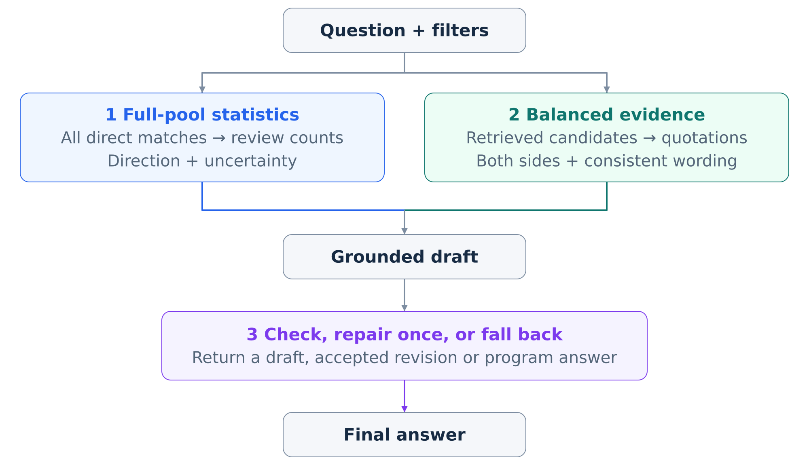
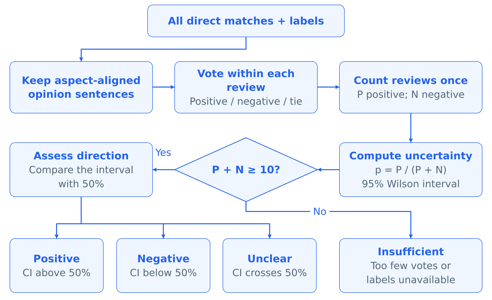
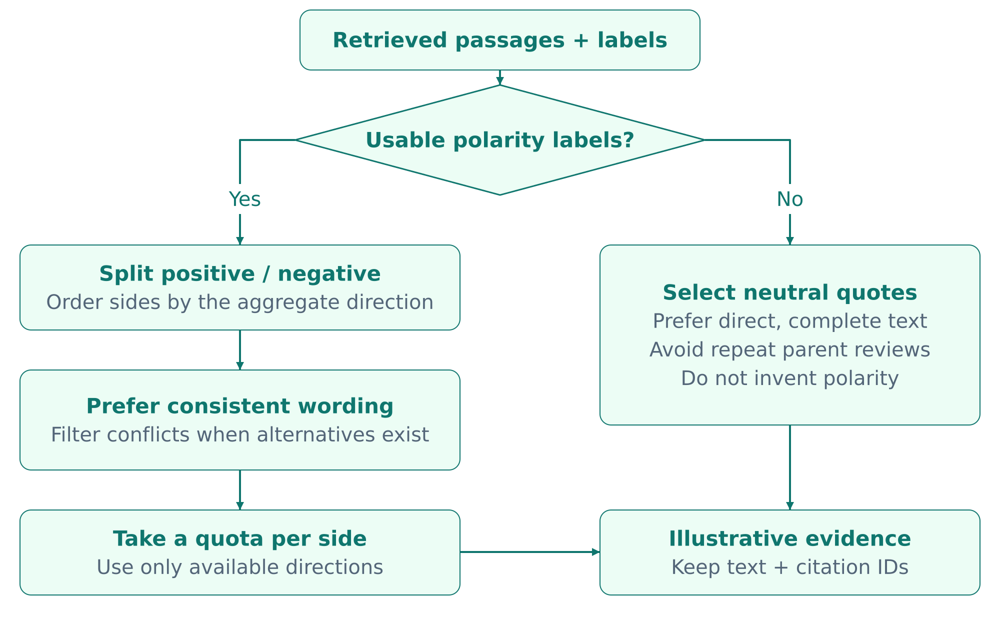
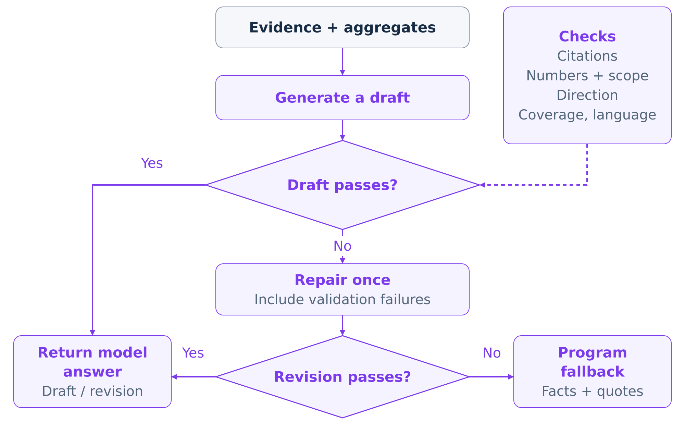
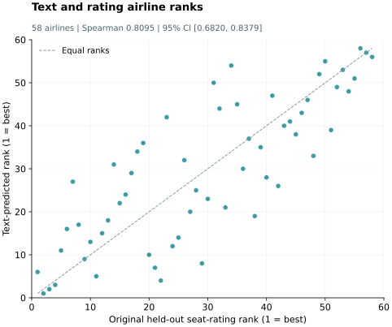

# Q5 — 下游创新

系统通过评论级统计和带引用的例子，回答关于航空乘坐体验的问题。仅检索到相关片段还不够：简短的排序列表可能偏离完整评论集的倾向，遗漏相反经历，也可能让流畅的答案带上错误数字。我们引入三个下游组件：**X：完整评论池统计；Y：正反平衡与一致性选例；Z：校验、一次修正与程序回退**。

## 5.1 设计总览

Q4 描述的方面、主观性和情感分类器为原句提供标签。三个组件利用这些标签与检索文本，分别完成汇总统计、选择例子和检查答案。

| 组件 | 问题 | 贡献 |
|---|---|---|
| X：完整评论池统计 | top-k 情感投票可能造成整体印象偏差；同一评论的多个句子可能被重复计数 | 先在每条评论内部汇总合格句子，再报告完整匹配池的分布与不确定性 |
| Y：平衡、一致的例子 | 简短证据列表可能掩盖分歧，或包含明显的标签—文本冲突 | 从可用的正反两侧选例，优先选择措辞相容、可读性好的引用 |
| Z：校验、修正与回退 | 引用编号有效，不保证数字正确或结论有依据 | 检查初稿，失败后修正一次；修正版仍失败时，用已提供事实和引用组装答案 |

*表 5.1：三个组件分别处理证据使用过程中的不同环节。*

*图 5.1：完整匹配评论池提供汇总统计，选中片段展示个体经历，二者共同支持生成与答案检查。*

我们在二十道题目上运行 X/Y/Z 的全部八种组合，评价各组件的贡献。5.2–5.4 节解释机制并展示实际例子，5.5 节报告回答级消融，5.6 节加入以乘客评分为参照的航司排名验证，5.7 节讨论成本及设计取舍。早期机制检查汇总在附录 Q5-B。

## 5.2 X：完整评论池统计

检索按相关性排序，而整体情感结论需要明确的评论集合。X 使用符合航司、舱位和细分属性文本线索的完整匹配池。在每条父评论内部，先汇总预测方面与问题一致的主观情感票，再将该评论计为正向或负向，每条评论只计一次。票数持平和没有合格票的评论分别记录。

正向比例为 **P / (P + N)**。明确的正向或负向结论要求至少十条可判定评论，且 95% Wilson 区间完全高于或低于 50%；否则报告证据不足或没有明确单向结论。统计描述的是匹配语料内的自动标签分布，缺失统计保持为不可用。

*图 5.2：评论级聚合避免将多个句子当作独立投票。持平评论和没有合格票的评论不进入 P + N。*

**例子：新加坡航空经济舱腿部空间（Q01）。** 基线前四条片段中有三条标签为负向；但完整匹配池有 78 条正向、20 条负向可判定评论，另有 3 条持平、30 条没有合格票。X 报告 **78/98 = 79.6% 正向**，Wilson 区间为 **[70.57%, 86.38%]**。答案因此可以说明汇总方向为正，同时引用座位拥挤的经历。相比之下，餐食分量问题 Q07 只有九条可判定评论，其中六正、三负，X 会说明证据不足以支持可靠的整体方向。

这一设计为汇总结论提供一致的依据：计数来自完整匹配评论池，引用用于说明个体经历，比例的分母也明确呈现给读者。

## 5.3 Y：正反平衡与一致性选例

有用的意见总结应当展示相关分歧。Y 按预测极性划分排序候选，每个可用方向最多选择两条。组内先根据情感词汇线索优先选择措辞与标签相容的片段，再考虑引用可读性；有合适替代项时排除明显冲突。如果没有可选的极性例子，就使用直接、完整的引用，不赋予情感标签。

*图 5.3：Y 结合情感覆盖与措辞—标签一致性。X 提供汇总方向时据此安排两侧顺序，否则使用固定顺序；最终可能少于四条片段。*

**例子：土耳其航空经济舱餐食质量（Q14）。** 基线前四条片段均被标为负向。Y 从相同的三十条候选中选出两正、两负，正面证据包括“The food was also very nice and delicious.”和“Two meals served, both of excellent quality.”。实际答案体现了这一变化：

| 配置 | 选中证据 | 生成答案摘录 |
|---|---|---|
| 基线（000） | 四条负向标签片段 | “Food quality and taste on Turkish Airlines in Economy Class are generally reported as poor.” |
| 仅 Y（010） | 两正、两负 | “Historical reviews show mixed experiences. Some passengers praised the food, describing it as "very nice and delicious" and noting "excellent quality" for both meals [1][2].” |

*表 5.2：冻结 Q14 答案的原文摘录。两组均不提供汇总统计，直接返回模型初稿；引用编号对应各配置自己的选中片段。*

基线概括为餐食品质普遍较差，Y 则呈现好坏并存的体验。Y 让相反经历可见，但不会把刻意平衡的引用当作正负各半的比例估计。词汇检查成本低，不过讽刺、否定结构和与具体方面相关的语义仍是难点。

## 5.4 Z：校验、一次修正与回退

Z 根据已提供的引用编号、数值信息、问题覆盖要求、语言及可用的汇总方向检查初稿。通过则返回；失败则将违规项反馈给模型，请求一次修正。修正版仍失败时，系统用当前配置选中的引用和允许使用的统计陈述组装答案。

*图 5.4：初稿与修正版接受同样的检查，最终答案再由独立的评测步骤评分。*

**例子：纠正 Q01 的统计。** 全组件开启时，初稿写成“78 out of 79.6% of direction-classified reviews were positive”，Z 拒绝了这条数字关系错误的论断。修正版恢复了 98 条评论、78 正、20 负，但改动了规定的统计陈述措辞，最终系统返回已提供的统计句和选中引用。这条记录展示了两种不同的触发原因：数字错误，以及数字修正后的格式违规。

限制为一次修正，可以约束额外生成成本。回退始终保留原配置的证据与信息权限：X 关闭时没有汇总统计，Y 关闭时仍保留排序靠前的片段。5.7 节分析该策略最终返回模型答案与程序答案的频率。

## 5.5 八种配置消融

**设置。** 11 月 2 日实验使用二十道曾用于开发的英文单航司、单属性问题。每题准备一个最多三十条候选的冻结池，排序不借助标签。所有配置共享候选池、生成提示和最多四条引用的预算。Qwen3-4B-Instruct-2507 同时承担生成与代理评分。每题的四份初稿覆盖四种 X/Y 设置，每份初稿由对应的 Z 关闭、开启策略共享。实验产生 **80 份初稿、54 次修正尝试和 160 条最终答案**。

**指标。** Faithfulness 是可核查论断中得到已提供上下文支持的比例。Answer Relevance 使用 0–4 分口径，再缩放到 [0, 1]。Context Precision 是展示片段中被判为相关的比例，评分时不读取答案。这些是自定义的模型代理分数，每个配置均使用二十道题。置信区间以题目为单位做 2,000 次配对 bootstrap，保留每题的八种配置，随机种子为 6127。题目、开关定义和评分细节见附录 Q5-A。

| 配置（XYZ） | Faithfulness | 相对基线差值 [95% 区间] | Answer Relevance | Context Precision |
|---|---:|---:|---:|---:|
| 基线 (000) | 0.8873 | — | 1.0000 | 0.8083 |
| 仅 X (100) | 0.8595 | −0.0278 [−0.0783, 0.0238] | 0.9875 | 0.8083 |
| 仅 Y (010) | 0.9179 | +0.0305 [−0.0292, 0.0882] | 1.0000 | 0.8708 |
| 仅 Z (001) | 0.9174 | +0.0301 [0.0026, 0.0629] | 1.0000 | 0.8083 |
| X+Y (110) | 0.9017 | +0.0143 [−0.0311, 0.0606] | 1.0000 | 0.8542 |
| X+Z (101) | 0.8675 | −0.0198 [−0.0799, 0.0393] | 0.9250 | 0.8083 |
| Y+Z (011) | 0.9404 | +0.0530 [0.0036, 0.1055] | 0.9750 | 0.8708 |
| X+Y+Z (111) | 0.8850 | −0.0023 [−0.0739, 0.0647] | 0.9750 | 0.8542 |

*表 5.3：配置均分及相对基线的 Faithfulness 配对差值。编码依次表示 X、Y、Z，1 表示开启；全部结果均为 n = 20。*

**配置层面的发现。** Y+Z 的 Faithfulness 观察均值最高，为 **0.9404**，相对基线变化为 **+0.0530 [0.0036, 0.1055]**。仅 Z 也有正向配对差值：**+0.0301 [0.0026, 0.0629]**。仅 Y 保持 Answer Relevance 为 **1.0000**，Context Precision 从 **0.8083 升至 0.8708**，后者差值为 **+0.0625 [−0.0500, 0.1750]**。

全部组件开启后，Faithfulness 为 **0.8850**，接近基线的 **0.8873**，差值为 **−0.0023 [−0.0739, 0.0647]**；Answer Relevance 变化为 **−0.0250 [−0.0625, 0.0000]**，Context Precision 变化为 **+0.0458 [−0.0625, 0.1500]**。Answer Relevance 降幅最大的配置是 X+Z，相对基线为 **−0.0750 [−0.1250, −0.0250]**。这表明组件组合并不会自动叠加收益。

**组件的平均贡献。** 每题内部比较组件开启与关闭，再对其他两个组件的四种设置取平均，得到该组件的边际效应。

| 组件 | Faithfulness 平均效应 | 95% 配对 bootstrap 区间 |
|---|---:|---:|
| X | −0.0373 | [−0.0750, 0.0012] |
| Y | +0.0283 | [−0.0015, 0.0592] |
| Z | +0.0110 | [−0.0151, 0.0354] |

*表 5.4：二十道配对题上的平均边际效应。*

Y 的 Faithfulness 平均正向估计最大，其次为 Z，X 的估计为负；三个边际区间均包含零。这与仅 Z、Y+Z 相对基线的正向区间并不矛盾，因为各比较针对不同的组件组合。Faithfulness 绝对值最大的交互为 XZ，**−0.0306 [−0.0756, 0.0165]**。这些比较属于探索性结果，区间未做多重检验调整，解释时也需考虑下文的评分审计。

## 5.6 航司排名与留出乘客评分的一致性

句子级分类指标衡量局部预测质量，Faithfulness 衡量答案是否遵循证据。排名评测补充一个面向最终结果的问题：**从评论文本推断的情感，能否保留乘客评分所呈现的航司排序？** 这将文本分析与航司推荐所需的比较判断联系起来。

我们为经济舱座位体验构造两份排名。**文本预测排名**使用专用诊断分类器，识别主观的座位相关句子并预测极性；先在每条评论内计算正向句子的比例，再对同一航司的评论取均值，使每条参与计算的评论权重相同。**参照排名**使用留出评论中各航司的 `seat_comfort` 均分。预测先保存并冻结，计分阶段才读取留出评分；训练侧评分用于弱监督。这里评价的是文本分类与评论聚合分支。

完整实验纳入 **58 家航司**，得到 **Spearman ρ = 0.8095**，**95% bootstrap 区间为 [0.6820, 0.8379]**。整个留出参照集中，8,365 条评论具有有效座位评分，3,152 条具有可用的座位情感预测。航司须至少有三十条参照评论和十五条可预测评论才能进入比较。划分、覆盖与重采样过程见附录 Q5-A.6。

*图 5.5：58 家航司上的文本与评分排名一致性。每个点代表一家航司，名次 1 为最好，虚线表示两份排名相同；图使用已保存的排名评测结果。*

较强的正相关表明，文本预测经评论级聚合后，保留了航司之间明显的座位体验差异。因此，排名评测在模型评分的答案评测之外，增加了来自乘客评分的验证证据。它支持文本到排名方法的实用价值，X/Y/Z 消融则单独衡量回答组件的贡献。乘客评分是整体座位舒适度的参照，并非每个细分属性或每条生成推荐的精确标准答案。

## 5.7 成本、评测质量与设计启示

**完整配置主要依赖修正与回退。** 八十条 Z 开启答案中，26 条采用初稿、7 条采用修正版、47 条使用回退。X+Z 和 X+Y+Z 的二十道题均触发修正；完整配置最终返回十六条程序答案、四条修正版。生成时间中位数为 **9.78 秒**，基线为 **4.83 秒**，仅 Y 为 **4.20 秒**。耗时包含初稿与修正，不含共享检索和评委调用，完整成本表见附录 Q5-A。

因此，完整配置的质量分数很大程度上反映的是“统计加引用”组装答案的表现。Q01 展示了低通过率的一个原因：检查器既要求数字正确，又要求统计措辞逐字匹配。下一步值得将语义错误与格式违规分开，并测量错误拒绝率。本轮 Z 消融评价的是检查、修正与回退的组合；七条被采用的修正版表示通过协议检查，不能单独证明修正带来质量提升。

**评委可靠性是主要测量弱点。** **134 份**不同的缓存答案评分中，有 **70 份**列出的不受支持例子数多于数值化的不受支持论断数。Q14 的评论计数已作为相同陈述提供给评委，却仍被判为无支持。Q04 仅改变选中片段顺序，Context Precision 就发生变化；这解释了为何 X 保留片段集合，其上下文评分效应仍不为零。上述不一致来自对保存的模型输出进行核查，报告保留全部原始分数。Bootstrap 区间描述题目间的波动，不能修正评委的系统误差。

**X 还需要更贴近其目标的结果指标。** 相对于上下文的 Faithfulness 奖励答案所作论断有据可依。X 关闭时，答案仅描述引用经历也可能得高分；X 则增加了需要评委核查的统计论断。因此，现有指标更直接衡量“如何使用已提供证据”，而非整体意见总结的准确性与完整性。后续应加入独立核查的数值准确性、汇总方向准确性，以及证据稀疏时是否适当保留判断。

结果支持将 Y 作为下一步优先验证的候选：它拓宽例子覆盖，Faithfulness 估计为正，生成成本也较低。Z 在部分配置中出现收益，但提供统计时大量使用回退。X 给出明确的语料级计数，其答案质量贡献仍待确定。排名评测补充了另一项发现：独立的文本到排名分支与留出乘客评分高度相关，支持用文本意见进行航司比较。下一轮应使用新题，对各配置预先固定抽样，并对模型答案和回退答案开展隐藏配置名称的人工评价。回答级消融的范围是二十道开发题及同一生成器／评委；语料统计还受到自动标签误差和评论来源选择偏差的影响。

## 附录 Q5-A：实验协议与详细结果

### Q5-A.1 题目与生成设置

题目为历史冒烟集的前二十道单航司、单属性问题，在评分前固定并改写为英文。共同问句为“What do historical reviews say about [attribute] on [airline] in [cabin]?”。

| ID | 航司 | 舱位 | 细分属性 |
|---|---|---|---|
| Q01 | Singapore Airlines | 经济舱 | 腿部空间 |
| Q02 | Air Canada rouge | 经济舱 | 腿部空间 |
| Q03 | Spirit Airlines | 经济舱 | 行李服务 |
| Q04 | Alaska Airlines | 经济舱 | 延误与取消处理 |
| Q05 | Emirates | 经济舱 | 退款与改签 |
| Q06 | Singapore Airlines | 经济舱 | 餐食种类与选择 |
| Q07 | Singapore Airlines | 经济舱 | 餐食分量 |
| Q08 | Singapore Airlines | 经济舱 | 座椅清洁度 |
| Q09 | Emirates | 经济舱 | 机上 Wi-Fi |
| Q10 | Qatar Airways | 商务舱 | 娱乐内容 |
| Q11 | British Airways | 高端经济舱 | 椅背倾斜与平躺能力 |
| Q12 | Cathay Pacific Airways | 商务舱 | 空乘态度 |
| Q13 | United Airlines | 经济舱 | 座椅宽度 |
| Q14 | Turkish Airlines | 经济舱 | 餐食品质与口味 |
| Q15 | AirAsia | 经济舱 | 客户支持 |
| Q16 | Etihad Airways | 商务舱 | 椅背倾斜与平躺能力 |
| Q17 | Frontier Airlines | 经济舱 | 行李服务 |
| Q18 | American Airlines | 经济舱 | 值机服务 |
| Q19 | Lufthansa | 经济舱 | 准点表现 |
| Q20 | Qantas Airways | 经济舱 | 机上饮品 |

*表 Q5-A.1：二十道题，每题运行八种配置。*

共同提示要求用不超过 160 词的英文回答，经历论断附引用，使用统计句时逐字复制已提供陈述；禁止从引用推断整体比例或多数情感。贪心生成每份初稿或修正版最多 480 token。实验在受控提示和明确回退流程下复用生产汇总、选例和校验函数，排除上位方面评分汇总、翻译、界面执行和程序直接回答捷径。范围是英文单航司评价问题。

### Q5-A.2 组件开关

| 因素 | 关闭 | 开启 |
|---|---|---|
| X | 对生成、校验和回退隐藏匹配语料计数、固定格式统计陈述与总体方向 | 提供完整直接匹配池的自动标签统计及方向判断 |
| Y | 初稿与回退均使用排序前四条候选；不足四条则全部使用 | 使用平衡、一致性选例，每个可用方向最多两条，无极性例子时采用中性引用路径 |
| Z | 返回真实模型初稿 | 使用生产校验器，最多请求一次真实修正，否则执行遵守当前配置的程序回退 |

X 改变可用统计，也可能改变 Y 所选片段的顺序，但保持选中片段集合不变；X 关闭时，Y 使用固定极性顺序。校验和回退只使用当前配置提供的信息。Y 平均选 3.50 条引用，基线为 3.95 条，因此其效应也包含引用数量变化。Y 将正反平衡与措辞一致性组合起来，Z 将检查、修正和回退组合起来。

### Q5-A.3 评分与统计过程

评委统计受支持的原子事实论断数与总论断数，计算 Faithfulness；没有论断时分数未定义。Answer Relevance 的 0 分为偏题、1 分为略有关联、2 分为部分回答、3 分为大体完整、4 分为完整回答精确问题，再除以四。Context Precision 为相关片段数除以展示片段数。相同有序问题／证据输入缓存上下文评分，相同评委输入缓存答案评分。160 条最终记录的三个指标均有定义。

每题的 X 主效应是四种 y/z 设置下 score(1,y,z) − score(0,y,z) 的平均，Y、Z 同理。XY 是 Y 开启与关闭时 X 效应的差，再对 Z 平均；XYZ 是 Z 开启与关闭时 XY 交互的差。区间取 2,000 次配对 bootstrap 均值的第 2.5 和 97.5 百分位。重采样以题目为单位，不按航司整群抽样，也不包含重新训练模型的不确定性；没有多重检验调整。X 的 Wilson 区间则描述自动评论标签的比例。

| 效应 | Faithfulness 差值及 95% 区间 | Answer Relevance 差值 | Context Precision 差值 | 配对题数 |
|---|---:|---:|---:|---:|
| X | −0.0373 [−0.0750, 0.0012] | −0.0219 | −0.0083 | 20 |
| Y | +0.0283 [−0.0015, 0.0592] | +0.0094 | +0.0542 | 20 |
| Z | +0.0110 [−0.0151, 0.0354] | −0.0281 | +0.0000 | 20 |
| XY | +0.0031 [−0.0720, 0.0703] | +0.0437 | −0.0167 | 20 |
| XZ | −0.0306 [−0.0756, 0.0165] | −0.0312 | +0.0000 | 20 |
| YZ | −0.0161 [−0.0686, 0.0345] | +0.0063 | +0.0000 | 20 |
| XYZ | −0.0171 [−0.0969, 0.0598] | +0.0625 | +0.0000 | 20 |

*表 Q5-A.2：主效应与交互效应，均基于二十道配对题；其他指标的完整区间保留在配套结果中。*

### Q5-A.4 生成成本

| 配置 | 修正尝试 | 采用修正版 | 程序回退 | 生成中位时间（秒） | P95（秒） | 平均引用数 |
|---|---:|---:|---:|---:|---:|---:|
| 000 | 0/20 | 0/20 | 0/20 | 4.83 | 5.42 | 3.95 |
| 100 | 0/20 | 0/20 | 0/20 | 5.38 | 5.81 | 3.95 |
| 010 | 0/20 | 0/20 | 0/20 | 4.20 | 5.00 | 3.50 |
| 001 | 7/20 | 0/20 | 7/20 | 5.03 | 8.96 | 3.95 |
| 110 | 0/20 | 0/20 | 0/20 | 4.99 | 5.56 | 3.50 |
| 101 | 20/20 | 3/20 | 17/20 | 10.70 | 12.21 | 3.95 |
| 011 | 7/20 | 0/20 | 7/20 | 4.57 | 8.59 | 3.50 |
| 111 | 20/20 | 4/20 | 16/20 | 9.78 | 12.11 | 3.50 |

*表 Q5-A.3：每个配置的计数分母均为二十条答案。耗时将共享初稿及可能的修正归入各策略；Z 关闭时直接返回未经检查的初稿。*

### Q5-A.5 运行环境与来源

运行使用 AMD Radeon RX 7800 XT、Transformers 后端与 BF16 Qwen/Qwen3-4B-Instruct-2507，revision 为 `cdbee75f17c01a7cc42f958dc650907174af0554`。记录环境为 PyTorch `2.14.0+rocm10.1.0`、HIP `7.16.26385`。分类器为 `eight-aspect-subjectivity-polarity-v4.1`，离线索引覆盖 529,031 个检索 ID，SHA-256 为 `c93627961da7f9b978890f5ba7c490dd659e7d9ed1e1c4c9a60cc1678eb63fde`。

冻结源码、候选上下文、提示、响应及模型／数据哈希标识完整运行，保存在 `outputs/q5_factorial_20261102_v3/`。此前准备尝试因模型客户端和输出目录错误中止，未计入其不完整缓存。运行标识仍为 v3，本次报告修订使用相同实验结果。

### Q5-A.6 航司排名评测协议

**划分与预测隔离。** 根据父评论 ID 的固定哈希，将约 20% 的父评论划入留出集。诊断训练排除原 1,100 句评测集的父评论及规范化文本，同时排除留出文本的规范化重复。预测输入仅包含 `chunk_id`、`review_id`、`text`、`airline`、`cabin`，分类器根据文本预测。保存的审计记录显示，训练与测试父评论重叠为零，规范化文本重叠也为零。预测哈希冻结后，计分阶段才打开参照评分。

**排名与覆盖。** 参照集包含留出经济舱评论中 `seat_comfort` 在 1–5 之间的记录。评论具有可用且被预测为座位相关、主观的句子时，才有文本分数。航司预测分数是可用评论正向比例的均值；参照分数是有效评分的均值，也包含没有文本预测的评论。预设门槛为三十条参照评论、十五条可预测评论，最终纳入 58 家航司。8,365 条参照评论和 3,152 条文本预测描述整个留出参照集；各航司覆盖情况及未纳入航司保存在配套文件中。

**不确定性与范围。** 并列分数采用平均名次。区间在固定纳入航司集合内进行 2,000 次父评论配对重采样，反映评论采样不确定性，不包含重新训练分类器的影响。排名评测使用专用诊断模型与聚合过程，与界面的原始评分排名及八种 X/Y/Z 配置分别独立。

## 附录 Q5-B：早期开发诊断

### Q5-B.1 机制检查：10 月 19 日

四十题冒烟集的前 25 题，在拆分五道航司比较题后得到三十个“航司×属性”单元。其中十八个具有明确自动汇总方向，十七个有正反例可用。

| 诊断 | 历史基线 | 增强机制 | 评测单位 |
|---|---:|---:|---|
| 与自动全量方向一致 | 12/18 | 18/18 | 18 个“航司×细分项”单元 |
| 正反均可用时的双侧例子覆盖 | 11/17 | 17/17 | 17 个符合条件的单元 |
| 明显标签—文本冲突 | 13 | 0 | 18 个单元中的冲突次数 |
| 反方向探针拦截 | 0/18 | 18/18 | 18 条合成答案 |

*表 Q5-B.1：机制诊断涵盖方向一致性、例子覆盖、词汇冲突与构造的反方向答案拦截。*

基线检索不借助标签，之后附加预测，对最多十条候选投票；增强路径结合标签辅助检索、完整评论池汇总，以及每个极性最多两条的选例。覆盖率比较基线前四条与选中例子；冲突计数使用另一份每个极性最多两条的基线列表。方向参考来自自动全量汇总，反方向探针保留有效引用并由规则判断。这些检查展示机制行为；历史上检索与选例同时变化，不能将全部收益归于 Y。

### Q5-B.2 模板比较与策略回放

10 月 19 日七题模板比较使用汇总方向明确的 Q01–Q06、Q12。固定模板组合方向陈述与引用，再由本地 Mac MLX 4bit Qwen 评分。top-10 方向加朴素例子的 Faithfulness 为 **0.8571**，切换全量方向后为 **0.8286**，加入平衡选例后为 **0.7929**，再加一致性过滤时不变；Context Precision 从 **0.9286 变为 1.0000**。这些是逐步叠加配置，平衡选例本身已包含一致性偏好。

10 月 31 日回放使用十二道开发题，八道英文、四道中文，涵盖评价、比较、事实、小规模评论切片和空切片，采用 Linux BF16 Qwen 与完整标签索引。五题由程序直接回答，七题调用生成器。完整策略下七道生成题全部回退；完整策略与立即回退策略在十二题上返回相同文本。七道生成题的“完整策略减去无校验策略”Faithfulness 为 **−0.0367 [−0.0912, −0.0048]**，代理分数来自同一模型。该回放没有发现修正步骤的收益。

一个中文案例还暴露了上游翻译错误：“Emirates first class”被译成埃塞俄比亚航空，回退保留了该译文。这个问题与多语言部署有关，本轮英文实验没有测试这一能力。历史诊断采用不同协议，与二十题消融分别报告。

## 附录 Q5-C：配套材料

以下项目内位置标识本节数据和代码。合并提交时，需要在公共提交材料部分提供可访问的数据包与源码包链接。

| 配套材料 | 项目内位置 |
|---|---|
| 本轮冻结协议、题目与哈希 | `outputs/q5_factorial_20261102_v3/protocol.json` |
| 候选池、上下文与缓存哈希 | `outputs/q5_factorial_20261102_v3/prepared/` 及同一运行目录下的 `prepared_manifest.json` |
| 全部 160 条最终答案与原始质量评分 | `outputs/q5_factorial_20261102_v3/answers/` |
| 初稿提示、响应、修正与校验决策 | 同一运行目录下的 `drafts/` 与 `policies/` |
| 上下文和答案评委缓存 | 同一运行目录下的 `context_judges/` 与 `answer_judges/` |
| 完整精度结果与审计 | 同一运行目录下的 `summary.json`、`analysis_audit.json`、`integrity_audit.json` |
| 冻结实现 | `outputs/q5_factorial_20261102_v3/frozen_source_tree/` |
| 本轮入口与复现说明 | `experiments/downstream_evaluation/factorial.py` 及同目录下的 `FACTORIAL.md` |
| 历史机制记录 | `experiments/final_auto_eval/results_20261019/` |
| 历史模板记录与构造代码 | `experiments/final_rag_eval/results_20261019/` 及 `experiments/final_rag_eval/run.py` |
| 排名评测冻结协议 | `outputs/c_q5_protocol_20261024_v1/protocol.json` |
| 排名预测、覆盖与结果 | `outputs/c_q5_ranking_20261024_v1/` |
| 排名评测实现与复现说明 | `experiments/downstream_evaluation/ranking.py` 及同目录下的 `README.md` |
| 十二题开发回放 | `outputs/c_yi_development_20261031/protocol_full_labels_r2/` 及同一开发目录下的 `answers_full_labels_r2/` |

复现按照 `FACTORIAL.md`，使用匹配的冻结输入与源码、本地模型服务及新的输出目录。排名评测复现遵循同一实验目录下 `README.md` 的排名说明，使用匹配的冻结协议及单独输出目录。
